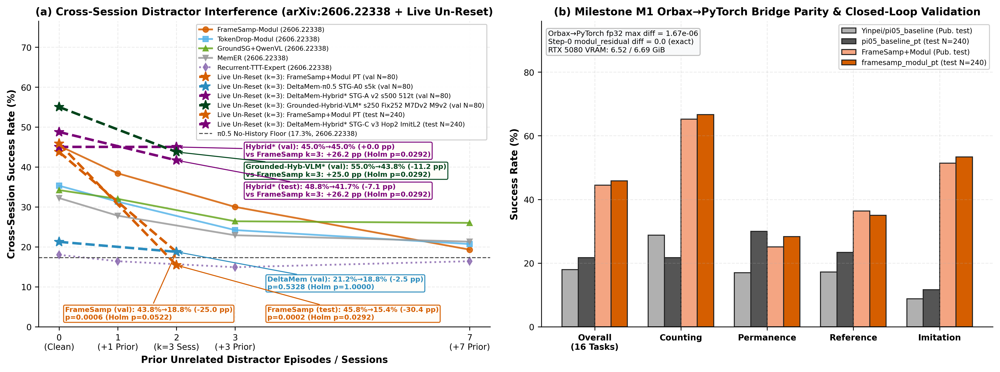

# 🤖 [Fun Project] DeltaLoop-VLA & DeltaMem-π0.5

📚 [Tech Report (PDF)](https://k1000dai.github.io/deltanet-looped-vla/tech_report.pdf) | 🌐 [Project Website](https://k1000dai.github.io/deltanet-looped-vla/) | 📊 [Phase 2 Results](RESULTS_PHASE2.md) | 📘 [Phase 1 Report](RESULTS_REPORT.md) | 🧾 [BibTeX](#citation)



We study constant-$O(1)$ associative memory and iterative multi-hop readout for long-horizon, non-Markovian robotic manipulation on the 16-task **RoboMME** benchmark. **Phase 1 (`DeltaLoop-VLA`)** isolates negative-eigenvalue Gated DeltaNet writing ($\beta_t \in (0, 2)$) from weight-tied multi-hop readout across synthetic benchmarks and `450M` `SmolVLA`. **Phase 2 (`DeltaMem-π0.5`)** scales multi-timescale Gated DeltaNet memory (`520 KB`), non-privileged surprise landmarks, automatic episode-boundary forgetting, and selective `Hop-2` refinement to `3.44B` **$\pi_{0.5}$**.

## Highlights

| Setting | Method | Fast State | 16-Task SR | Note |
| :--- | :--- | :---: | :---: | :--- |
| **Held-out `test240` ($k=3$ un-reset)** | `FrameSamp+Modulator` (PyTorch) | `2.00 MiB` | `15.42%` | `-30.42 pp` cross-session collapse |
| **Held-out `test240` ($k=3$ un-reset)** | **DeltaMem-π0.5 (`Hybrid + Hop-2`)** | **`2.39 MiB`** | **`41.67%`** | **`+26.25 pp` (`2.70×`, $p_{\text{Holm}} = 0.0292$)** |
| **Held-out `test240` ($k=1$ clean)** | `π0.5` Baseline (PyTorch) | `0 B` | `21.67%` | `223.1 ms/chunk` memoryless baseline |
| **Held-out `test240` ($k=1$ clean)** | `FrameSamp+Modulator` (PyTorch) | `2.00 MiB` | `45.83%` | `+24.17 pp` vs. Base |
| **Held-out `test240` ($k=1$ clean)** | **DeltaMem-π0.5 (`Hybrid + Hop-2`)** | **`2.39 MiB`** | **`48.75%`** | **`+27.08 pp` vs. Base (`387.8 ms/chunk`, `7.04 GiB`)** |
| **Synthetic `1A-Online` / `1A-Retro`** | **DeltaLoop ($\beta \in (0, 2)$, $L=6$)** | **`520 KB`** | **`100.0%` / `97.1%`** | Swap tracking (`100%` OOD) & pointer chasing (`80.4%` OOD) |

> Full 77-run evaluation logs, $m=146$ Holm–Bonferroni statistical tests, `val80` selection-bias disclosures (`60.00%` specialist / `57.50%` single-ckpt), and negative results are documented in [RESULTS_PHASE2.md](RESULTS_PHASE2.md) and [RESULTS_REPORT.md](RESULTS_REPORT.md).

## Setup

```bash
git clone https://github.com/k1000dai/deltanet-looped-vla.git
cd deltanet-looped-vla
uv venv --python 3.11 && source .venv/bin/activate
uv pip install torch numpy scipy matplotlib safetensors transformers einops sentencepiece
```

For closed-loop ManiSkill3 evaluation, install [RoboMME](https://github.com/RoboMME/robomme_benchmark) under `external/robomme_benchmark`.

## Quick Start

**1. Synthetic Write vs. Multi-Hop Read Benchmark (Phase 1)**

```bash
uv run python scripts/run_synthetic.py --task all --seeds 0 1 2 --out-dir results/synthetic
```

**2. Convert Official MME-VLA $\pi_{0.5}$ Checkpoints to PyTorch ($\le 10^{-5}$ `fp32` parity)**

```bash
uv run python scripts/convert_pi05.py \
  --orbax-dir /path/to/perceptual_framesamp_modul/79999 \
  --output-dir checkpoints/framesamp_modul_pt
```

**3. Train `DeltaMem-π0.5` (`HybridSurpriseGDNBridge` + `EpisodeBoundaryForgetGate` + `Hop-2`)**

```bash
uv run python scripts/train_pi05_mem.py \
  --arch p2_m6_hybrid --stage stage_c --max-steps 250 \
  --pi05-ckpt checkpoints/framesamp_modul_pt --cache-dir data/robomme_pi05_cache
```

**4. Evaluate Closed-Loop on 16-Task RoboMME (`k=1` single-session & `k=3` un-reset interference)**

```bash
# Single-session held-out test240 (16 tasks x 15 episodes)
uv run python scripts/eval_pi05.py \
  --ckpt-dir checkpoints/framesamp_modul_pt \
  --memory-ckpt checkpoints/phase2/m6_hybrid_stageC_hop2/ckpt_final.pt \
  --split test --episodes-per-task 15 --parallel-workers 2

# Un-reset cross-session interference (k = 3 consecutive episodes without reset)
uv run python scripts/eval_pi05.py \
  --ckpt-dir checkpoints/framesamp_modul_pt \
  --memory-ckpt checkpoints/phase2/m6_hybrid_stageC_hop2/ckpt_final.pt \
  --split test --episodes-per-task 15 --interference-k 3 --parallel-workers 2
```

## Repo Structure

```text
├── analysis/                  # Mechanistic linear probes & publication figure scripts
├── docs/
│   ├── figures_phase2/        # Phase-2 figures & m=146 paired McNemar/Holm test JSONs
│   ├── website/               # GitHub Pages project website (index.html, tech_report.pdf)
│   └── SURVEY_PHASE2.md       # Literature & primary-source leaderboard survey
├── paper/                     # LaTeX technical report (tech_report.tex, tech_report.pdf)
├── results/                   # Raw JSON logs (synthetic, SmolVLA, and 77 Phase-2 runs)
├── scripts/                   # Entry points for conversion, cache extraction, training & eval
├── src/
│   ├── memory/                # Gated DeltaNet (beta in (0,2)) & multi-timescale GDN
│   ├── loop/                  # Weight-tied Prelude-Core-Coda loop & CRN adaptive halting
│   ├── models/                # Phase-1 DeltaLoop-VLA & SmolVLA-DeltaLoop models
│   ├── pi05/                  # Native PyTorch 3.44B pi0.5 + SigLIP + ActionExpert bridge
│   ├── pi05_mem/              # HybridSurpriseGDNBridge, ForgetGate, DeltaGround-VLM, Hop-2
│   └── robomme_eval/          # Parallel ManiSkill3 closed-loop & interference runner
├── RESULTS_PHASE2.md          # Complete Phase-2 report, ablations, caveats & negative results
└── RESULTS_REPORT.md          # Complete Phase-1 mechanistic & SmolVLA report
```

## Citation

```bibtex
@techreport{k1000dai2026deltaloopvla,
  title  = {[Fun Project] DeltaLoop-VLA and DeltaMem-pi0.5: Multi-Timescale Gated DeltaNet Memory,
            Non-Privileged Surprise Landmarks, and Interference-Robust Multi-Hop Readout},
  author = {k1000dai},
  year   = {2026},
  note   = {Technical Report. Primarily written and created using Gemini 4 Carbon.},
  url    = {https://k1000dai.github.io/deltanet-looped-vla/}
}
```

---

**AI Authorship & Creation Disclosure:** This `[Fun Project]` research, codebase, experimental evaluation, LaTeX technical report, and project website were primarily written and created using **Gemini 4 Carbon**.  
*(本研究・コード実装・実験評価・LaTeX 技術レポートおよびプロジェクトページは、主に **Gemini 4 Carbon** を使用して書かれ・作られました。)*
