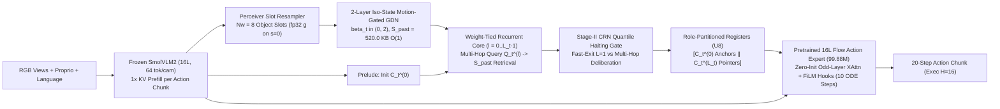

# [Fun Project] DeltaLoop-VLA & DeltaMem-π0.5: Expressive Associative Memory Writing and Iterative Multi-Hop Readout for Long-Horizon Robotic Manipulation

**[Fun Project]** • **DeltaLoop-VLA** & **Pretrained `SmolVLA-DeltaLoop`** & **`DeltaMem-π0.5`** — Constant-$O(1)$ Motion-Gated Negative-Eigenvalue Gated DeltaNet Memory (`520 KB`) + Weight-Tied Dynamic Multi-Hop Readout (`Prelude–Recurrent Core–Coda`) + Two-Stage Common-Random-Number (`CRN`) Adaptive Halting for Non-Markovian Visuomotor Control on [RoboMME](https://github.com/RoboMME/robomme_benchmark) (`16` Tasks, `10 Hz` ManiSkill3) and Multi-Session Un-Reset Deployment.

[](#)
[](https://k1000dai.github.io/deltanet-looped-vla/)
[-paper%2Ftech__report.pdf-B31B1B)](paper/tech_report.pdf)
[](RESULTS_REPORT.md)
[-009E73)](RESEARCH_PLAN.md)
[](docs/SURVEY.md)
[](docs/PRETRAINED_VLA_DESIGN.md)
[](RESULTS_PHASE2.md)
[-00441B)](NEXT_GOAL_PLAN.md)
[](docs/SURVEY_PHASE2.md)

---

## Phase 2: `DeltaMem-π0.5` on the 3.44B `π0.5` Backbone (Complete)

Phase 2 moves the memory stack from the Phase-1 `450M` cached-`SmolVLA` floor (`< 10%` SR) onto end-to-end `3.44B` `π0.5`. The PyTorch bridge reproduces the official `MME-VLA` checkpoints with `1.67e-6` `fp32` parity. The memory stack is a multi-timescale 2-layer GDN, a `512`-token `Hybrid` perceptual–surprise memory, a self-predicted `<y, x>` grounding VLM (`DeltaGround-VLM`), and adaptive `Hop-2` refinement. Phase 2 covers `77` closed-loop runs with a Holm–Bonferroni family of `m = 146` paired tests. The full report, including every caveat below, is in [RESULTS_PHASE2.md](RESULTS_PHASE2.md).

| Setting (episodes) | Model | SR | vs. `π0.5` Base | vs. `FrameSamp+Modul` (PyTorch) | vs. `T²Mem` (published `test`, `56.83%`) |
| :--- | :--- | :---: | :--- | :--- | :--- |
| **Held-out `test240`, `k = 1`** | `Hybrid StageC Hop-2 ImitL2` (`7.04 GiB`, `387.8 ms/chunk`) | **`48.75%`** (`117/240`, CI `[42.5, 55.0]`) | `+27.08 pp`, `p_McN = 2.18e-11`, `p_holm = 0.0292` | `+2.92 pp`, **n.s.** (`24:17`, `p_McN = 0.349`) | **below** (CI excludes `56.83%`) |
| **Held-out `test240`, `k = 3` un-reset** | same checkpoint, episode-paired distractor streams | **`41.67%`** (`100/240`) | — | **`+26.25 pp`** vs. `15.42%` (`69:6`, `p_McN = 1.16e-14`, `p_holm = 0.0292`) | — |
| Held-out `test240`, `k = 1` | Single-ckpt `unified_m7dv2_m9v4pyr_hop2` (`8.82 GiB`) | `47.50%` (`114/240`) | `+25.83 pp`, `p_holm = 0.0292` | `+1.67 pp`, n.s. (`p_McN = 0.627`) | below |
| `val80` (model selection) | Prompt-routed specialist `m10 + Hop-2` (`L ∈ {1,2,3}`) | `60.00%` (`48/80`) | `+41.25 pp`, `p_holm = 0.0292` | `+16.25 pp`, `p_McN = 0.0044` unadjusted, **`p_holm = 0.152` (n.s.)** | not comparable (different split) |
| `val80` (model selection) | Single-ckpt `unified_m7dv2_m9v4pyr_hop2` / `m9v5adv` / `m7dv2_m9v3hr16_hop2` | `57.50%` (`46/80`) | `+38.75 pp`, `p_holm = 0.0292` | `+13.75 pp`, `p_holm ≥ 0.294` (n.s.) | not comparable |

> [!WARNING]
> **Caveats (`RESULTS_PHASE2.md` §1.1).**
> 1. We do **not** beat `T²Mem` overall on held-out `test`. Our best is `48.75%`, and we ran only `15` episodes per task, not the official `50`. On `test240`, `Reference = 45.0%` vs. `T²Mem` `38.67%` is our only suite-level point estimate above `T²Mem`, and that gap is within noise.
> 2. The `val80` `60.00%` and `57.50%` figures are best-of-`63` selections on the same `80` episodes, so they are biased upward. No `val80` win over `FrameSamp+Modul` survives Holm correction.
> 3. No `test240` gain over `FrameSamp+Modul` at `k = 1` is significant. Only the gains over memoryless `π0.5` are significant.
> 4. The defensible Phase-2 contribution is **robustness to un-reset cross-episode interference**. On held-out `test240` at `k = 3`, the champion scores `41.67%` vs. `15.42%` for `FrameSamp+Modul` (`+26.25 pp`, `69:6`, `p_McN = 1.16e-14`, `p_holm = 0.0292`). Two disclosures apply: (a) it is robustness, not immunity — the champion still drops `-7.08 pp` from its own `k = 1` (`p_holm = 0.0984`), `4.3×` smaller than `FrameSamp`'s `-30.42 pp`; and (b) the gain is largely driven by `EpisodeBoundaryForgetGate` (`src/pi05_mem/adapter.py`), which resets memory on instruction-cosine jumps, `exec -> demo` transitions, and scene cuts whereas upstream `FrameSamp+Modul` has no reset heuristic (`64 -> 65` [`+0.7 pp`] vs. `60 -> 20` [`-29.6 pp`] on the `9` demo tasks, and `53 -> 35` [`-17.1 pp`] vs. `50 -> 17` [`-31.4 pp`] on the `7` no-demo tasks).
> 5. Every result above `25%` warm-starts from public non-privileged `MME-VLA` checkpoints (Track 2). None uses test-time oracle subgoals or simulator masks.
> 6. Negative results: `P2-M12` reactive `exec_h = 4`, decoupled `Symbolic-VLM` `m10v4` (`Permanence = 5%`), continuous-KV-only `P2-M11`, and Wave-16 `m9v5adv` (did not clear its pre-registered `> 60%` `val80` gate, so it was not run on `test`).

Phase-2 figures (CPU-rendered, [analysis/plot_phase2.py](analysis/plot_phase2.py)): [leaderboard & suites](docs/figures_phase2/fig_p2_1_leaderboard_and_suites.png) | [per-task heatmap](docs/figures_phase2/fig_p2_2_per_task_heatmap.png) | [latency & state Pareto](docs/figures_phase2/fig_p2_3_efficiency_pareto_and_state.png) | [`k = 3` interference & bridge parity](docs/figures_phase2/fig_p2_4_interference_and_parity.png). The paired tests (`m = 146`) are in [phase2_paired_tests.json](docs/figures_phase2/phase2_paired_tests.json).

---

## Key Highlights & Verified Empirical Findings

Across **87 shortcut-free synthetic GPU runs (3 seeds)**, **4,160 closed-loop ManiSkill3 rollouts on controlled scratch backbones (`2,400` Cycle 2A + `1,760` Cycle 3A)**, and **6,560 official `test` closed-loop rollouts across 20 runs (`10,720` total closed-loop RoboMME rollouts across 46 runs) on a 450M pretrained `lerobot/smolvla_base` backbone (frozen `SmolVLM2` prefix with `8×8`-pooled cached tokens, `100` demos/task) across all 16 RoboMME tasks (`14/14` pretrained checkpoints and `202` mechanistic probe entries = `64 + 56 + 82` in Cycles 2A–4)**:

1. **Primary Closed-Loop Finding — Persistent $O(1)$ GDN State Compression (`M5`), Not Multi-Hop Coda Looping (`M7`), Drives Single-Session RoboMME Gains ([Cycles 2A](results/robomme/cycle2a/SUMMARY_CYCLE2A.md), [3A](results/robomme/cycle3a/SUMMARY_CYCLE3A.md), & [3B](results/robomme/cycle3b_smolvla/SUMMARY_CYCLE3B.md)):**
   - Across **all three single-session (`k = 0`) closed-loop RoboMME suites**, **single-pass 2-layer Gated DeltaNet (`M5`, $L=1$, `520 KB` $O(1)$ state) outperforms multi-hop looped Coda variants (`M6`/`M7`)**: **`11.25%` (`18/160`) vs `7.50%` (`12/160`)** in Cycle 2A (`H4f: p = 0.2374` NS), **`12.50%` (`20/160`, Holm-significant `H1c: p = 0.0002`, `p_holm = 0.0038` vs `m0` `3.12%`) vs `8.12%` (`m6`) / `6.25%` (`m7`)** in Cycle 3A, and **`5.25%` (`21/400`, Holm-significant `H1c: p = 0.0012`, `p_holm = 0.0420` vs `m0` `1.50%`, matching `FrameSamp-32`'s `9.0%` on `Reference`) vs `4.00%–4.50%` (`16–18/400`)** on pretrained `SmolVLA` (`H4c: Δ = -1.00%, p = 0.4722` NS).
   - After family-wise **Holm-Bonferroni multiplicity correction (`m = 38` tests)** in Cycle 3B/4, the `4` unconditionally Holm-significant tests are **`FrameSamp-32 > M0` (`H_MS2: p <= 0.0002, p_holm <= 0.0076`; `H0b: p = 0.0002, p_holm = 0.0074`), `M7 < FrameSamp-32` at `k = 0` (`H_MS3: -3.61%, p = 0.0008, p_holm = 0.0288`), and single-pass `M5 (2L GDN) > M0` (`H1c: p = 0.0012, p_holm = 0.0420`)**; nominal `M7 > M0` differences (`H1a: +2.75%, p = 0.0136`; 3-seed `H_MS1: 4.03% ± 0.24% [29/720] vs 2.22% ± 0.87% [16/720], +1.81%, p = 0.0414` unadjusted) do not survive Holm correction.
2. **Where Weight-Tied Multi-Hop Readout Helps vs. Breaks Down ([Cycle 1](results/synthetic/SUMMARY_CYCLE1.md) & Intra-Checkpoint Analysis):**
   - **Synthetic Write vs. Read Dissociation (`Cycle 1`):** On `Task 1A-Online` ($S_8$ container swaps), expanding $\beta_t \in (0, 2)$ lifts 1-layer GDN from `25.1%` ($\beta \in (0, 1)$) to **`100.0 ± 0.0%`** (ID & OOD $k=5,6$; note the 4L causal Softmax Transformer's `15.6%` reflects under-optimization under the shared 1-epoch budget rather than a theoretical attention ceiling). On post-cue `Task 1A-Retro`, separating **`Forward`-only** vs **all-order** evaluation shows that on `Forward` causal chains (`A -> B` before `B -> C`), single-pass, write-loop, parallel-query, and untied 6-layer baselines stay near chance (`17.1–21.4%` ID; depth-optimization difficulty without shared gradients cannot be excluded for untied $L=6$), whereas weight-tied **DeltaLoop reaches `94.8–97.1%` `Forward` ID (`96.3–97.9%` all-order) and extrapolates to `76.4–80.4%` `Forward` (`82.3–85.0%` all-order) at zero-shot OOD $k=5$, before degrading sharply at $k=6$ (`37.0–37.3%` `Forward`, `51.2–54.9%` all-order; overall OOD `56.8–58.9%` `Forward`, `68.1–68.6%` all-order)**, while Stage-II halting cuts ID loop FLOPs by `56%`.
   - **Intra-Checkpoint `M7` Depth Sensitivity & Compute-Saving Pareto (`Cycle 3B`):** Truncating multi-depth-trained `smolvla_m7_deltaloop` weights to `Fixed L=1` yields `2.75%` (`11/400`), recovering to `4.00%` (`16/400`, `Fixed L=2`, two-sided `p = 0.1652` NS), `4.25%` (`17/400`, `Adaptive CRN` at `1.11` hops, two-sided `p = 0.0696` NS; one-sided `p₁ = 0.0348`), and `4.50%` (`18/400`, calibrated `Latent L2 Conv` at `2.28` hops, two-sided `p = 0.0654` NS; one-sided `p₁ = 0.0327`), while remaining below dedicated $L=1$ `M5` (`5.25%`). Within `M7`, Stage-II `CRN` matches `Latent L2 Conv` (`H5b: p = 0.8990` NS) at **`-51.3%` fewer recurrent hops**.
3. **Cross-Session Un-Reset Interference (`k = 3` Prior Distractor Episodes Across `M2`, `M5`, and `M7`) & Negative-Eigenvalue / Register Diagnostics:**
   - **Buffer Saturation, Closed-Loop `M5` Slow-Head Sensitivity, & Floor-Regime `k = 3` Uncertainty:** Streaming `k = 3` prior un-reset episodes (~`960` distractor frames) degrades `FrameSamp-32` from `8/160 (5.00%) -> 2/160 (1.25%)` on scratch (`p = 0.0648`) and **`14/240 (5.83%) -> 3/240 (1.25%)` on pretrained `SmolVLA` (`H7b: Δ = -4.58%`, two-sided `p = 0.0032` unadjusted, `p_holm = 0.1056` NS; `cos(k=3) = 0.526`, `+20.99 px` probe drift)**. Critically, **single-pass `M5` also drops in closed loop (`12/240 [5.00%] -> 2/240 [0.83%]`, `H7d: -4.17%`, primary exact two-sided McNemar `p = 0.0020` unadjusted, `p_holm = 0.0680` NS on `10` lost / `0` gained pairs; finite-sample bootstrap `p <= 0.0002`, `p_holm <= 0.0074`; `H7g` DiD vs `M2` `p = 0.9140` NS)** despite high offline cosine invariance (`cos(k=3) = 0.992`), as residual slow-head superposition (`t_{1/2} <= 512` frames) perturbs single-hop `Reference`/`Imitation` rollouts. Multi-depth `SmolVLA-DeltaLoop` (`M7`) shows no significant within-model drop (`10/240 [4.17%] -> 7/240 [2.92%]`, `H7c: p = 0.4544` NS), **yet every `k = 3` head-to-head and DiD comparison favoring `M7` (`H7a` vs `M2` `p = 0.1950`, `H7f` vs `M5` `p = 0.0670`, `H7h` DiD vs `M2` `p = 0.0976`, `H7i` DiD vs `M5` `p = 0.1238`, all `p_holm = 1.0000`) is statistically non-significant** at `< 6%` floor counts.
   - **Negative Eigenvalues on Real Video (`Cycles 2A/3A`) & Role-Partitioned Registers (`U7`/`U8`):** On 10 Hz robot video, Cycle 2A `m4` (`5.62%` vs `m3` `10.00%`, `H2: p = 0.1046` NS) motivated static-frame motion gating (`U5`); under bundled `v3` upgrades (`U1–U5`), `m4` ($\beta \in (0, 2)$) and `m3` ($\beta \in (0, 1)$) tie identically at **`10.62%` (`H2a: p = 1.0000`)**, showing **zero closed-loop $\beta \in (0, 2)$ SR advantage** over $\beta \in (0, 1)$ on RoboMME, while chunk-boundary Coda write-back hurts (`-5.00%, p = 0.0478` unadj.). In Cycle 4, `U7` (`N_c = 16`, `4.00%`, `16/400`) lowers `fm_loss` (`0.03155`) and Probe-1 zero-shot error (`4.36 px`), while `U8` (`4+4` Anchor+Pointer, `520 KB` iso-state) achieves lowest offline `aux_loss` (`0.00443`) & `ground_loss` (`0.01707`) and `-0.41 px` multi-hop probe sharpening, but exhibits Hop-1 early exit under `CRN` (`96.1% L=1`, `12/400 = 3.00%` vs `15/400 = 3.75%` at `Fixed L=2`, `H9f: p = 0.4832` NS). All cached-VLM `SmolVLA` runs operate in a **`< 10%` absolute SR floor regime** vs published end-to-end 3B `π0.5` (`17.9%` base, `44.5%` `FrameSamp+Modul`; see `RESULTS_REPORT.md` §8).

---

## Architecture Overview (`DeltaLoop-VLA` & `SmolVLA-DeltaLoop`)



### Core Mathematical Components
1. **Motion-Gated Negative-Eigenvalue Gated DeltaNet (`src/memory/gated_deltanet.py`):**
   $$\mathbf{S}_u^{(h)} = \exp\!\left(g_u^{(h)}\right)\!\left(\mathbf{I} - \beta_u^{(h)} \mathbf{k}_u^{(h)}{\mathbf{k}_u^{(h)}}^\top\right)\mathbf{S}_{u-1}^{(h)} + \beta_u^{(h)} \mathbf{v}_u^{(h)}{\mathbf{k}_u^{(h)}}^\top, \quad \beta_u^{(h)} = 2\,\sigma\!\left(\mathbf{w}_\beta^\top \mathbf{z}_u + \gamma_m \log(1 + m_{\tau_m}) + b_\beta\right) \in (0, 2)$$
   with frame-level `fp32` log-decay $g_u^{(h)} \le 0$ masked to slot $s = 0$, fused $(d_v + 1)$ key-occupancy tracking, and demo-preserving causal cutoff $\tau_{\mathrm{cutoff}}(t) = \max(\tau_{\mathrm{exec}}, \tau(t) - 15)$ preventing current-frame self-retrieval.
2. **Weight-Tied Dynamic Multi-Hop Readout & Role-Partitioned Registers (`src/models/smolvla_deltaloop.py`):**
   - `Prelude -> Weight-Tied Core -> Coda` iteratively queries frozen `(S1_past, S2_past)` (`532,480 B` = `520.0 KB` `fp32` across 2 iso-state layers, $H=8, d_k=d_v=128$).
   - **Cycle 4A (`U7`, `--num-coda-tokens 16`)** expands homogeneous Coda slots; **Cycle 4B (`U8`, `--anchor-hop0-coda --num-coda-tokens 4`)** keeps recurrent pointer updates concentrated at $N_c = 4$ while passing `[c_0 + role_0, c_l + role_1]` (`8` tokens, `+768` params) into the 8 odd layers `{1,3,5,7,9,11,13,15}` of `SmolVLA`'s 16-layer Flow Action Expert (`0.0` initialization diff vs `lerobot/smolvla_base`).
3. **Two-Stage Common-Random-Number (`CRN`) Relative-Quantile Halting (`CRNHaltingGate`):**
   - Stage I trains all depths $l \in \{0..3\}$ simultaneously under shared $(\boldsymbol{\epsilon}_t, \tau_t)$ (`1` VLM prefill/sample); Stage II freezes EMA weights and trains a lightweight hazard gate on $M_{\mathrm{CRN}} = 8$ noise draws calibrated at the `p58` advantage quantile (`exact 42.19%` positive rate across all 6 Stage-II runs).

---

## Headline Empirical Summary

| Tier & Model | Active Params | State Bytes | Single-Session SR (`k = 0`) | Live Un-Reset Clutter (`k = 3`) | Key Mechanistic / Statistical Result (`Two-Sided p` & `Holm`) |
| :--- | :---: | :---: | :---: | :---: | :--- |
| **Scratch `v3` `m0_memoryless`** ($L=1$) | `28.6M` | `0 B` | `3.12%` *(5/160, 8-task `val`)* | `3.12%` *(Markov)* | Memoryless baseline |
| **Scratch `v3` `m2_framesamp_modul`** (`32` slots) | `32.8M` | `24.0 KB` | `5.00%` *(8/160)* | `1.25%` *(2/160, `p=0.0648` NS)* | Buffer saturates (`+18.45 px` $k=3$ drift) |
| **Scratch `v3` `m5_gdn2layer_b2_l1`** ($L=1$) | `40.0M` | `520.0 KB` | **`12.50%`** *(20/160)* | — | **`H1c: +9.38%` vs `m0` (`p=0.0002`, `p_holm=0.0038`); beats looped `m6`/`m7`!** |
| **Scratch `v3` `m6_deltaloop_b2_adaptive`** | `37.6M` | `516.0 KB` | `8.12%` *(13/160, `56.2 ms/ch`)* | `3.12%` *(5/160, `H7b p=0.3460` NS)* | `H1b: +5.00%` vs `m0` (`p=0.0344` unadj., `p_holm=0.4648` NS) |
| **Pretrained `smolvla_m0_base`** ($L=1$) | `407.1M` | `0 B` | `1.50%` *(6/400; 3-seed `2.22 ± 0.87%`)* | `1.50%` *(Markov)* | `0.0%` on `12/16` tasks (`s42`; 3-seed counts `3, 6, 7 / 240`) |
| **Pretrained `smolvla_m1_rdvla_loop4`** ($L=4$) | `436.8M` | `0 B` | `2.50%` *(10/400)* | `2.50%` *(Markov)* | `H0a: p = 0.3806` NS vs `m0` (memoryless loop fails) |
| **Pretrained `smolvla_m2_framesamp`** (`32` slots) | `436.9M` | `24.0 KB` | **`6.50%`** *(26/400; 3-seed `7.64 ± 2.44%`)* | `1.25%` *(3/240, `H7b p=0.0032` unadj., Holm NS)* | **`H0b: p=0.0002` & `H_MS2: p<=0.0002` (Holm `<0.05`)**; `k=3` drops `14/240 -> 3/240` |
| **Pretrained `smolvla_m5_gdn2l_l1`** ($L=1$) | `444.0M` | `520.0 KB` | **`5.25%`** *(21/400, `238.2 ms/ch`)* | `0.83%` *(2/240, `H7d` McN `p=0.0020`, Holm `0.0680` NS)* | **`H1c: +3.75%` vs `m0` (`p=0.0012, p_holm=0.0420`); #1 `k=0` GDN**, drops at `k=3` (`12/240 -> 2/240`; boot `p_holm<=0.0074`) |
| **Pretrained `smolvla_m7_deltaloop_L1`** (`Fixed L=1`) | `444.2M` | `520.0 KB` | `2.75%` *(11/400, `238.7 ms/ch`)* | — | Truncated `L=1` readout on multi-depth-trained `M7` weights (`6/16` tasks) |
| **Pretrained `smolvla_m7_deltaloop_L2`** (`Fixed L=2`) | `444.2M` | `520.0 KB` | `4.00%` *(16/400, `239.7 ms/ch`)* | — | `H4b: +1.25%` vs `M7 L=1` (`p = 0.1652` NS) |
| **Pretrained `smolvla_m7_deltaloop_adaptive`** ($N_c=4$) | `444.2M` | `520.0 KB` | `4.25%` *(17/400; 3-seed `4.03 ± 0.24%`)* | `2.92%` *(7/240, `H7c p=0.4544` NS)* | `H1a: p=0.0136`, `H_MS1: p=0.0414` (Holm NS); **`H_MS3 < M2` (`p_holm=0.0288`)**; `k=3` vs `M2`/`M5` NS (`p=0.195/0.067`) |
| **Pretrained `smolvla_m7_deltaloop_coda_conv`** (`tau=0.06`) | `444.2M` | `520.0 KB` | `4.50%` *(18/400, `L_t = 2.28`, `239.7 ms`)* | — | `H4e: +1.75%` vs `M7 L=1` (`p = 0.0654` NS; `p₁ = 0.0327`); `H5b` vs `CRN` `p = 0.8990` NS |
| **Pretrained `smolvla_m7_deltaloop_q16` (`U7`)** ($N_c=16$) | `444.2M` | `520.0 KB` | `4.00%` *(16/400, `Chunk-0 L_t = 1.95`)* | — | `H8a: p=0.0246` unadj. (Holm NS); lowest `fm_loss` (`0.03155`), ZS `U4` `4.36 px`, `VidPlOrd` `3/25 (12%)` |
| **Pretrained `smolvla_m7_deltaloop_anchor` (`U8 CRN`)** (`4+4`) | `444.2M` | `520.0 KB` | `3.00%` *(12/400, `L_t = 1.04`)* | — | Lowest `aux_loss` (`0.00443`) & `ground_loss` (`0.01707`); `96.1% L=1` Anchor-Shortcut exit |
| **Pretrained `smolvla_m7_deltaloop_anchor_L2` (`U8 L=2`)** (`4+4`) | `444.2M` | `520.0 KB` | `3.75%` *(15/400, `239.1 ms`)* | — | `H9f: +0.75%` vs `Anchor CRN` (`p = 0.4832` NS); `H9g: +2.25%` vs `m0` (`p = 0.0612` NS) |

---

## Repository Directory Map

```text
deltanet-looped-vla/
├── RESULTS_REPORT.md                 # Full paper-grade experimental & mechanistic report (Cycles 1–4)
├── RESEARCH_PLAN.md                  # Verified research plan (v3.5 Final: Hypotheses H0–H9i & H_MS1–H_MS3)
├── RESULTS_PHASE2.md                 # Phase-2 DeltaMem-π0.5 report (77 runs, m=146 Holm tests, §1.1 caveats)
├── NEXT_GOAL_PLAN.md                 # Phase-2 goal plan & milestone tracker (v3.1)
├── IDEA.md / EXP_TIPS.md             # Original seed research idea & experimental loop guidelines
├── docs/
│   ├── SURVEY.md                     # Deep LLM + VLA literature survey (45 primary refs, exact equations)
│   ├── PRETRAINED_VLA_DESIGN.md      # Pretrained lerobot/smolvla_base grafting & complexity specification
│   ├── INFRA_NOTES.md                # Miyabi GH200 (aarch64) & local RTX 5080 (Blackwell sm_120) notes
│   ├── SURVEY_PHASE2.md              # Phase-2 survey: T²Mem, MME-VLA, Dual-Stream, LaCT, Titans, ATLAS, MolmoAct ...
│   └── figures_phase2/               # Phase-2 figures fig_p2_1..4 (PNG + PDF) & phase2_paired_tests.json
├── src/
│   ├── memory/                       # Motion-gated beta in (0,2) GDN, fp32 log-decay, Perceiver readout
│   │   ├── gated_deltanet.py
│   │   ├── multi_timescale_gdn.py
│   │   └── readout.py
│   ├── loop/                         # Weight-tied Prelude-Core-Coda & Stage-II CRN adaptive halting
│   │   ├── looped_core.py
│   │   └── halting.py
│   ├── synthetic/                    # Cycle 1 shortcut-audited datasets (1A-Online, 1A-Retro, 1B)
│   ├── models/                       # Scratch DeltaLoop-VLA & Pretrained SmolVLA-DeltaLoop policies
│   │   ├── deltaloop_vla.py
│   │   ├── smolvla_deltaloop.py      # Zero-init odd-layer hooks, U7 (N_c=16), & U8 (--anchor-hop0-coda)
│   │   ├── robomme_policy_wrapper.py
│   │   └── smolvla_policy_wrapper.py
│   ├── robomme_data/                 # Memory-mapped SigLIP & SmolVLA shard loaders + constants
│   ├── pi05/                         # Phase 2: PyTorch π0.5 (PaliGemma-2B + ActionExpert-300M) Orbax bridge
│   ├── pi05_data/                    # Phase 2: dual-view SigLIP cache dataset & grounded-subgoal targets
│   ├── pi05_mem/                     # Phase 2: DeltaMem / Hybrid / DeltaGround(-VLM) / unified adapters
│   └── robomme_eval/                 # Subprocess-isolated ManiSkill3 closed-loop evaluator & bootstrap CI
├── scripts/
│   ├── run_synthetic.py              # Cycle 1 3-seed synthetic benchmark runner (87 runs)
│   ├── extract_smolvla_cache.py      # 16-task SmolVLA VLM vision-connector cache & MEAN_STD extractor
│   ├── train_robomme.py              # Cycle 2A/3A scratch RoboMME trainer (v2 & --v3 modes)
│   ├── train_smolvla.py              # Cycle 3B/4 pretrained SmolVLA-DeltaLoop 2-stage trainer
│   ├── eval_cycle2a.py               # Cycle 2A parallel ManiSkill3 closed-loop evaluator
│   ├── eval_cycle3.py                # Cycle 3A parallel ManiSkill3 evaluator (incl. k=3 interference)
│   ├── eval_smolvla.py               # Cycle 3B/4 16-task official test split parallel evaluator
│   ├── convert_pi05.py               # Phase 2: Orbax -> PyTorch π0.5 conversion + fp32 parity verification
│   ├── extract_pi05_cache.py         # Phase 2: 16-task dual-view 2048-D SigLIP + grounded-subgoal cache
│   ├── train_pi05_mem.py             # Phase 2: DeltaMem-π0.5 / Hybrid / DeltaGround-VLM trainer
│   └── eval_pi05.py                  # Phase 2: closed-loop RoboMME evaluator (val/test, --interference-k)
├── analysis/
│   ├── probe_robomme_state.py        # Scratch frozen-state & multi-hop localization probes (Probes 1–3)
│   ├── probe_smolvla_state.py        # Pretrained SmolVLA backboneless mechanistic probes (Probes 1–3)
│   ├── subgoal_grounding.py          # Parser for RoboMME grounded_subgoals `<x, y>` pixel coordinates
│   ├── plot_synthetic.py             # CPU figure generator for Cycle 1 (fig1–fig4 PNG + vector PDF)
│   ├── plot_robomme.py               # CPU figure generator for Cycles 2A, 3A, & 3B/4 (fig5–fig8 PNG + PDF)
│   └── plot_phase2.py                # Phase-2 CPU figures + Holm-adjusted paired tests (fig_p2_1..4)
└── results/
    ├── synthetic/                    # SUMMARY_CYCLE1.md, JSON logs, & figures/fig1..fig4.{png,pdf}
    ├── phase2/                       # Phase-2 closed-loop eval JSONs (val80 / test240 / *_interfk3)
    └── robomme/
        ├── cycle2a/                  # SUMMARY_CYCLE2A.md, 15 run JSONs, paired_comparisons, probes
        ├── cycle3a/                  # SUMMARY_CYCLE3A.md, 11 run JSONs, paired_comparisons, probes
        ├── cycle3b_smolvla/          # SUMMARY_CYCLE3B.md, 16-task test JSONs, k=3 controls, 82 probes
        └── figures/                  # Publication figures: cycle2a/, cycle3a/, cycle3b_smolvla/ (fig5..fig8)
```

---

## Reproducibility Guide

### 1. Cycle 1: Shortcut-Free Synthetic Mechanistic Suite (`87` Runs, 3 Seeds)

```bash
# Run all three synthetic benchmarks (Task 1A-Online, Task 1A-Retro, Task 1B) across seeds 0, 1, 2
python scripts/run_synthetic.py --task all --seeds 0 1 2 --out-dir results/synthetic --resume

# Regenerate Cycle 1 publication figures (fig1–fig4, strictly CPU-only)
CUDA_VISIBLE_DEVICES="" python analysis/plot_synthetic.py
```

### 2. Cycles 2A & 3A: Controlled Scratch `DeltaLoop-VLA` on RoboMME

```bash
# Train controlled Cycle 3A v3 scratch models (U1–U5 enabled) on pre-extracted SigLIP shards
python scripts/train_robomme.py --v3 \
    --models m0_memoryless m2_framesamp_modul m3_gdn_b1_l1 m4_gdn_b2_l1 \
             m5_gdn2layer_b2_l1 m6_deltaloop_b2 m7_deltaloop_2l_b2 \
    --steps 16000 --stage2-steps 1000 --seed 42 \
    --output-dir checkpoints/robomme/cycle3a

# Self-contained CPU smoke test of frozen-state Probes 1–3 (< 20s, 0 GPU VRAM)
CUDA_VISIBLE_DEVICES="" python analysis/probe_robomme_state.py --smoke-test

# Full frozen-state mechanistic Probes 1–3 on cached SigLIP validation shards
python analysis/probe_robomme_state.py --device cuda \
    --checkpoints checkpoints/robomme/eval_mirror_cycle3a/m0_memoryless.pt \
                  checkpoints/robomme/eval_mirror_cycle3a/m2_framesamp_modul.pt \
                  checkpoints/robomme/eval_mirror_cycle3a/m3_gdn_b1_l1.pt \
                  checkpoints/robomme/eval_mirror_cycle3a/m4_gdn_b2_l1.pt \
                  checkpoints/robomme/eval_mirror_cycle3a/m5_gdn2layer_b2_l1.pt \
                  checkpoints/robomme/eval_mirror_cycle3a/m6_deltaloop_b2.pt \
                  checkpoints/robomme/eval_mirror_cycle3a/m7_deltaloop_2l_b2.pt \
    --shard-dir /work/gj26/b20098/datasets/robomme_siglip_v1 \
    --output-json results/robomme/cycle3a/mechanistic_probes.json

# Closed-loop ManiSkill3 evaluation (k=0 standard + k=3 un-reset cross-session interference)
python scripts/eval_cycle3.py --dataset val --episodes 20 --workers 5 --no-sync
python scripts/eval_cycle3.py --dataset val --episodes 20 --workers 5 --distractor-sessions 3 \
    --only-archs m2_framesamp_modul m6_deltaloop_b2 --no-sweeps --no-sync
```

### 3. Cycles 3B & 4: Pretrained 450M `SmolVLA-DeltaLoop` Across All 16 RoboMME Tasks

```bash
# (Step 0) Verify zero-init step-0 parity & invariants on CPU (< 15s, 0 GPU VRAM)
CUDA_VISIBLE_DEVICES="" python scripts/train_smolvla.py --self-test-only --device cpu

# (Step 1) Pre-extract 16-task SmolVLM2 vision-connector shards & per-horizon (20, 8) MEAN_STD stats
python scripts/extract_smolvla_cache.py \
    --dataset-root /work/gj26/b20098/datasets/robomme_data_lerobot \
    --output-dir /work/gj26/b20098/datasets/robomme_smolvla_v1

# (Step 2a) Train Cycle 3B controlled SmolVLA suite (10k Stage-I + 800 Stage-II CRN steps)
python scripts/train_smolvla.py \
    --models smolvla_m0_base smolvla_m1_rdvla_loop4 smolvla_m2_framesamp \
             smolvla_m5_gdn2l_l1 smolvla_m7_deltaloop \
    --steps 10000 --stage2-steps 800 --seed 42 \
    --output-dir checkpoints/robomme/cycle3b_smolvla

# (Step 2b) Train Cycle 4A U7 (Homogeneous N_c = 16 Coda slots, exact 520 KB iso-state)
python scripts/train_smolvla.py \
    --models smolvla_m7_deltaloop --num-coda-tokens 16 \
    --steps 10000 --stage2-steps 800 --seed 42 \
    --output-dir checkpoints/robomme/cycle3b_smolvla_q16

# (Step 2c) Train Cycle 4B U8 (Role-Partitioned 4 Hop-0 Anchors + 4 Hop-l Pointers, +768 params)
python scripts/train_smolvla.py \
    --models smolvla_m7_deltaloop --anchor-hop0-coda --num-coda-tokens 4 \
    --steps 10000 --stage2-steps 800 --seed 42 \
    --output-dir checkpoints/robomme/cycle3b_smolvla_u8_anchor

# (Step 3) Run fast backboneless mechanistic Probes 1–3 across all 16-task pretrained checkpoints
python analysis/probe_smolvla_state.py --device cuda \
    --checkpoints checkpoints/robomme/cycle3b_smolvla/smolvla_m0_base.pt \
                  checkpoints/robomme/cycle3b_smolvla/smolvla_m1_rdvla_loop4.pt \
                  checkpoints/robomme/cycle3b_smolvla/smolvla_m2_framesamp.pt \
                  checkpoints/robomme/cycle3b_smolvla/smolvla_m5_gdn2l_l1.pt \
                  checkpoints/robomme/cycle3b_smolvla/smolvla_m7_deltaloop.pt \
                  checkpoints/robomme/cycle3b_smolvla/smolvla_m7_deltaloop_q16.pt \
                  checkpoints/robomme/cycle3b_smolvla/smolvla_m7_deltaloop_anchor.pt \
    --shard-dir /work/gj26/b20098/datasets/robomme_smolvla_v1 \
    --output-json results/robomme/cycle3b_smolvla/mechanistic_probes.json

# (Step 4) Closed-loop 16-task official `test` evaluation on checkpoints/robomme/eval_mirror_cycle3b
# Note: `--seed` sets the policy flow-matching noise seed (default 7; keep fixed at 7 across all runs
# to preserve episode-matched pairing). Training seeds {43, 44} are selected via checkpoint stems in
# `--mirror-dir`, and `coda_conv` threshold tau is auto-calibrated on random dummy inputs unless `--no-coda-conv` is passed.
python scripts/eval_smolvla.py --dataset test --episodes 25 --seed-episodes 15 --interf-episodes 15 \
    --focused-wave2 --workers 5 --no-sync

# Evaluate specific multi-seed stems (training seed 43, keeping policy noise `--seed 7` fixed):
python scripts/eval_smolvla.py --dataset test --seed-episodes 15 --no-sweeps --no-coda-conv \
    --only-stems smolvla_m0_base_s43 smolvla_m2_framesamp_s43 smolvla_m7_deltaloop_s43 --workers 5 --no-sync

# Evaluate k=3 cross-session un-reset interference on single-pass 2L GDN (M5, N=240 matched test eps):
python scripts/eval_smolvla.py --dataset test --episodes 15 --distractor-sessions 3 \
    --only-stems smolvla_m5_gdn2l_l1 --no-sweeps --no-coda-conv --workers 5 --no-sync
```

### 4. Publication Figure Generation (`300 DPI PNG` + `Vector PDF`, Strictly CPU-Only)

```bash
# Cycle 2A, Cycle 3A, and Cycle 3B/4 Pretrained SmolVLA figure suites (fig5–fig8 each)
CUDA_VISIBLE_DEVICES="" python analysis/plot_robomme.py \
    --eval-dir results/robomme/cycle2a \
    --probe-json results/robomme/cycle2a/mechanistic_probes.json \
    --out-dir results/robomme/figures/cycle2a

CUDA_VISIBLE_DEVICES="" python analysis/plot_robomme.py \
    --eval-dir results/robomme/cycle3a \
    --probe-json results/robomme/cycle3a/mechanistic_probes.json \
    --out-dir results/robomme/figures/cycle3a

CUDA_VISIBLE_DEVICES="" python analysis/plot_robomme.py \
    --eval-dir results/robomme/cycle3b_smolvla \
    --probe-json results/robomme/cycle3b_smolvla/mechanistic_probes.json \
    --out-dir results/robomme/figures/cycle3b_smolvla
```

### 5. Phase 2: `DeltaMem-π0.5` on 3.44B `π0.5` (Local RTX 5080 Evaluation, CPU-Only Figures)

```bash
# (Step 1) Convert the official MME-VLA Orbax checkpoints to PyTorch and verify fp32 velocity parity
python scripts/convert_pi05.py --verify-from-fixture   # see RESULTS_PHASE2.md §3.1 for per-checkpoint args

# (Step 2) Held-out test240 evaluation of the Phase-2 test champion (15 eps x 16 tasks, policy seed 7)
DISPLAY="" external/robomme_benchmark/.venv/bin/python scripts/eval_pi05.py \
  --ckpt-dir checkpoints/phase2/init/perceptual_framesamp_modul_pt \
  --memory-adapter pi05_mem.adapter:build_eval_adapter_imitation_l2 \
  --memory-ckpt checkpoints/phase2/p2_m5_hybrid_v3_stageC_hop2/step_000200_ema.pt \
  --dataset test --episodes 15 --seed 7 \
  --output results/phase2/test_m5_hybrid_v3_stageC_hop2_imitation_l2.json

# (Step 3) Same checkpoint under k=3 un-reset cross-episode interference (episode-paired with FrameSamp k=3)
DISPLAY="" external/robomme_benchmark/.venv/bin/python scripts/eval_pi05.py \
  --ckpt-dir checkpoints/phase2/init/perceptual_framesamp_modul_pt \
  --memory-adapter pi05_mem.adapter:build_eval_adapter_imitation_l2 \
  --memory-ckpt checkpoints/phase2/p2_m5_hybrid_v3_stageC_hop2/step_000200_ema.pt \
  --dataset test --episodes 15 --seed 7 --interference-k 3 \
  --output results/phase2/test_m5_hybrid_v3_stageC_hop2_imitation_l2_interfk3.json

# (Step 4) Phase-2 figures + Holm-Bonferroni paired tests (strictly CPU-only)
CUDA_VISIBLE_DEVICES="" external/robomme_benchmark/.venv/bin/python analysis/plot_phase2.py \
  --eval-dir results/phase2 \
  --out-dir docs/figures_phase2 \
  --stats-out docs/figures_phase2/phase2_paired_tests.json
```

---

## Documentation & Figure Index

- **Reports & Design Docs:**
  - [RESULTS_REPORT.md](RESULTS_REPORT.md) — Full experimental, statistical, and mechanistic paper report (`§1–§9`, `38` Cycle 3B/4 paired bootstrap tests [`75` total], `10,720` closed-loop rollouts, `202` probes).
  - [RESEARCH_PLAN.md](RESEARCH_PLAN.md) — Verified research plan (`v3.5 Final`), causal hypotheses (`H0–H9i` & `H_MS1–H_MS3`), and complete execution log.
  - [docs/SURVEY.md](docs/SURVEY.md) — Deep LLM + Robotics/VLA literature survey (`45` primary references, exact equations & failure modes).
  - [docs/PRETRAINED_VLA_DESIGN.md](docs/PRETRAINED_VLA_DESIGN.md) — Exact tensor shapes, hook equations, and FLOP/memory accounting for `SmolVLA-DeltaLoop`.
  - [docs/INFRA_NOTES.md](docs/INFRA_NOTES.md) — Hybrid Miyabi GH200 + RTX 5080 execution notes and Vulkan/EGL isolation.
  - [RESULTS_PHASE2.md](RESULTS_PHASE2.md) — Phase-2 `DeltaMem-π0.5` report (`77` runs, `m = 146` Holm tests). Read §1.1 Statistical Caveats first.
  - [NEXT_GOAL_PLAN.md](NEXT_GOAL_PLAN.md) — Phase-2 goal plan, milestone tracker, and final status (`v3.1`).
  - [docs/SURVEY_PHASE2.md](docs/SURVEY_PHASE2.md) — Phase-2 primary-source survey (`T²Mem`, `MME-VLA`, `Dual-Stream`, `RoboMME-Interference`, LLM fast-weight memory, VLA test-time refinement).
- **Generated Figure Suites (`PNG` + `PDF`):**
  - **Phase 2 `DeltaMem-π0.5` (`docs/figures_phase2/`):** [fig_p2_1_leaderboard_and_suites.png](docs/figures_phase2/fig_p2_1_leaderboard_and_suites.png) | [fig_p2_2_per_task_heatmap.png](docs/figures_phase2/fig_p2_2_per_task_heatmap.png) | [fig_p2_3_efficiency_pareto_and_state.png](docs/figures_phase2/fig_p2_3_efficiency_pareto_and_state.png) | [fig_p2_4_interference_and_parity.png](docs/figures_phase2/fig_p2_4_interference_and_parity.png)
  - **Cycle 1 Synthetic (`results/synthetic/figures/`):** [fig1_mechanistic_dissociation.png](results/synthetic/figures/fig1_mechanistic_dissociation.png) | [fig2_k_L_staircase_heatmap.png](results/synthetic/figures/fig2_k_L_staircase_heatmap.png) | [fig3_halting_and_qk_alignment.png](results/synthetic/figures/fig3_halting_and_qk_alignment.png) | [fig4_task1b_multiscale.png](results/synthetic/figures/fig4_task1b_multiscale.png)
  - **Cycle 2A Scratch (`results/robomme/figures/cycle2a/`):** [fig5](results/robomme/figures/cycle2a/fig5_robomme_main_suites.png) | [fig6](results/robomme/figures/cycle2a/fig6_pareto_and_adaptive_halting.png) | [fig7](results/robomme/figures/cycle2a/fig7_cross_session_interference.png) | [fig8](results/robomme/figures/cycle2a/fig8_mechanistic_probes_and_signflip.png)
  - **Cycle 3A Scratch `v3` (`results/robomme/figures/cycle3a/`):** [fig5](results/robomme/figures/cycle3a/fig5_robomme_main_suites.png) | [fig6](results/robomme/figures/cycle3a/fig6_pareto_and_adaptive_halting.png) | [fig7](results/robomme/figures/cycle3a/fig7_cross_session_interference.png) | [fig8](results/robomme/figures/cycle3a/fig8_mechanistic_probes_and_signflip.png)
  - **Cycle 3B/4 Pretrained `SmolVLA` (`results/robomme/figures/cycle3b_smolvla/`):** [fig5_robomme_main_suites.png](results/robomme/figures/cycle3b_smolvla/fig5_robomme_main_suites.png) | [fig6_pareto_and_adaptive_halting.png](results/robomme/figures/cycle3b_smolvla/fig6_pareto_and_adaptive_halting.png) | [fig7_cross_session_interference.png](results/robomme/figures/cycle3b_smolvla/fig7_cross_session_interference.png) | [fig8_mechanistic_probes_and_signflip.png](results/robomme/figures/cycle3b_smolvla/fig8_mechanistic_probes_and_signflip.png)
- **LaTeX Technical Report & Project Website:**
  - [paper/tech_report.pdf](paper/tech_report.pdf) ([paper/tech_report.tex](paper/tech_report.tex)) — Compiled LaTeX technical report summarizing Phase 1 & Phase 2.
  - [https://k1000dai.github.io/deltanet-looped-vla/](https://k1000dai.github.io/deltanet-looped-vla/) ([docs/website/index.html](docs/website/index.html)) — Interactive GitHub Pages project showcase.

---

## AI Authorship & Creation Note

本研究・コード実装・実験評価・LaTeX 技術レポートおよびプロジェクトページは、主に **Gemini 4 Carbon** を使用して書かれ・作られました。  
*(This research, codebase, experimental evaluation, LaTeX technical report, and project website were primarily written and created using **Gemini 4 Carbon**.)*
