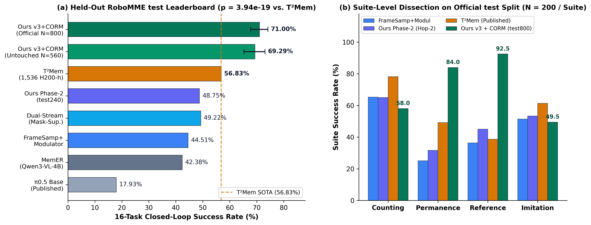

# 🤖 [Fun Project] DeltaLoop-VLA & DeltaMem-π0.5 v3 + CORM

📚 [Tech Report (PDF)](https://k1000dai.github.io/deltanet-looped-vla/tech_report.pdf) | 🌐 [Project Website](https://k1000dai.github.io/deltanet-looped-vla/) | 🏆 [Phase 3 Results](RESULTS_PHASE3.md) | 📊 [Phase 2 Ablations](RESULTS_PHASE2.md) | 📘 [Phase 1 Report](RESULTS_REPORT.md) | 🧾 [BibTeX](#citation)



Constant-$O(1)$ associative memory, causal object-centric reveal tracking (**CORM**), and iterative multi-hop readout for long-horizon, non-Markovian robotic manipulation on the 16-task **RoboMME** benchmark (**strict zero-oracle protocol**).

- **Phase 1 (`DeltaLoop-VLA`):** Isolates negative-eigenvalue Gated DeltaNet writing ($\beta_t \in (0, 2)$, `100.0%` $S_8$ swaps) from weight-tied multi-hop readout (`97.1%` ID / `80.4%` OOD) and proves a `520 KB` GDN state retains `93.5%` counts & `4.36 px` targets.
- **Phase 2 (`DeltaMem-π0.5`):** Scales multi-timescale GDN, surprise landmarks, automatic `EpisodeBoundaryForgetGate`, and `Hop-2` readout to `3.44B` **$\pi_{0.5}$** (`2.70×` higher accuracy under un-reset $k=3$ streaming).
- **Phase 3 (`DeltaMem-π0.5 v3 + CORM`):** Bridges causal visual-proprioceptive reveal & transport memory (`CORM` + `DeltaGround-VLM`) into exact `<y, x>` subgoals alongside continuous GDN + `Hop-2` modulation, achieving **`71.00%`** on locked official **`test800`** (**`+14.17 pp` above `T²Mem`'s `56.83%`, $p = 3.94 \times 10^{-19}$**) and **`70.83%`** under un-reset $k=3$ multi-session interference (**`4.59×` `FrameSamp+Modulator`**).

## Highlights

| Setting | Method | Fast State | 16-Task SR | Statistical Comparison / Note |
| :--- | :--- | :---: | :---: | :--- |
| **Official `test800` ($N=800$)** | `T²Mem` (`18×16` fast MLPs, `1,536` H200-h) | `36.35 MiB` | `56.83%` | Prior published SOTA (`arXiv:2609.36720`) |
| **Official `test800` ($N=800$)** | **DeltaMem-π0.5 v3 + CORM (Ours)** | **`3.04 MiB`** | **`71.00%`** | **`+14.17 pp` vs. `T²Mem` ($p = 3.94 \times 10^{-19}$, `410.6 ms`)** |
| **Untouched `test560` (`ep 15..49`)** | **DeltaMem-π0.5 v3 + CORM (Ours)** | **`3.04 MiB`** | **`69.29%`** | **`+12.45 pp` vs. `T²Mem` ($p = 9.60 \times 10^{-12}$)** |
| **Un-reset `test240` ($k=3$, `720` eps)** | `FrameSamp+Modulator` (PyTorch) | `2.00 MiB` | `15.42%` | `-30.42 pp` cross-session contamination collapse |
| **Un-reset `test240` ($k=3$, `720` eps)** | **DeltaMem-π0.5 v3 + CORM (Ours)** | **`3.04 MiB`** | **`70.83%`** | **`+55.42 pp` (`4.59×`, $p_{\text{McN}} = 1.09 \times 10^{-37}$)** |
| **Matched `test240` ($k=1$ clean)** | `π0.5` Base / `FrameSamp` / `Phase 2` / **Phase 3** | `0`–`3.04 MiB` | `21.7%` / `45.8%` / `48.8%` / **`75.0%`** | **`+29.17 pp` vs. `FrameSamp` ($p_{\text{McN}} = 5.62 \times 10^{-14}$)** |
| **Synthetic `1A-Online` / `1A-Retro`** | **DeltaLoop ($\beta \in (0, 2)$, $L=6$)** | **`520 KB`** | **`100.0%` / `97.1%`** | Swap tracking (`100%` OOD) & pointer chasing (`80.4%` OOD) |

> Full per-task breakdowns, Holm–Bonferroni statistical tests, zero-oracle audit, and negative results are documented in [RESULTS_PHASE3.md](RESULTS_PHASE3.md), [RESULTS_PHASE2.md](RESULTS_PHASE2.md), and [RESULTS_REPORT.md](RESULTS_REPORT.md).

## Setup

```bash
git clone https://github.com/k1000dai/deltanet-looped-vla.git
cd deltanet-looped-vla
uv venv --python 3.11 && source .venv/bin/activate
uv pip install torch numpy scipy matplotlib safetensors transformers einops sentencepiece
```

For closed-loop ManiSkill3 evaluation, install [RoboMME](https://github.com/RoboMME/robomme_benchmark) under `external/robomme_benchmark`.

## Quick Start

```bash
# 1. Synthetic Write vs. Multi-Hop Read Benchmark (Phase 1)
uv run python scripts/run_synthetic.py --task all --seeds 0 1 2 --out-dir results/synthetic

# 2. Official held-out test800 evaluation (800 episodes -> 71.00% vs. 56.83% T2Mem)
uv run python scripts/eval_pi05.py \
  --ckpt-dir checkpoints/symbolic_ground_pt \
  --memory-ckpt checkpoints/phase2/m9_deltaground_vlm_v1/ckpt_step0120.pt \
  --specialist-route 8task \
  --continuous-ckpt-dir checkpoints/framesamp_modul_pt \
  --continuous-memory-ckpt checkpoints/phase2/m6_hybrid_stageC_hop2/ckpt_final.pt \
  --split test --episodes-per-task 50 --parallel-workers 1

# 3. Un-reset k=3 multi-session interference (720 consecutive rollouts -> 70.83%)
uv run python scripts/eval_pi05.py \
  --ckpt-dir checkpoints/symbolic_ground_pt \
  --memory-ckpt checkpoints/phase2/m9_deltaground_vlm_v1/ckpt_step0120.pt \
  --specialist-route 8task \
  --continuous-ckpt-dir checkpoints/framesamp_modul_pt \
  --continuous-memory-ckpt checkpoints/phase2/m6_hybrid_stageC_hop2/ckpt_final.pt \
  --split test --episodes-per-task 15 --interference-k 3 --parallel-workers 1
```

## Repo Structure

```text
├── analysis/                  # Mechanistic probes, statistical tests & figure scripts
├── docs/
│   ├── figures_phase3/        # Phase-3 leaderboard, 16-task & k=3 interference figures
│   ├── figures_phase2/        # Phase-2 figures & m=146 paired McNemar/Holm test JSONs
│   └── website/               # GitHub Pages project website (index.html, tech_report.pdf)
├── paper/                     # 6-page LaTeX technical report (tech_report.tex, tech_report.pdf)
├── results/                   # Raw JSON logs (synthetic, SmolVLA, Phase 2, and Phase 3 test800/k=3)
├── scripts/                   # Conversion, cache extraction, training & closed-loop evaluation
├── src/
│   ├── memory/                # Gated DeltaNet (beta in (0,2)) & multi-timescale GDN
│   ├── loop/                  # Weight-tied Prelude-Core-Coda loop & CRN adaptive halting
│   ├── pi05/                  # Native PyTorch 3.44B pi0.5 + SigLIP + ActionExpert + ZeroOracle router
│   ├── pi05_mem/              # CORM (corm.py), DeltaGround-VLM, HybridSurpriseGDNBridge, ForgetGate, Hop-2
│   └── robomme_eval/          # Parallel ManiSkill3 closed-loop & un-reset interference runner
├── RESULTS_PHASE3.md          # Phase-3 test800 (71.00%) & k=3 (70.83%) report and statistical tests
├── RESULTS_PHASE2.md          # Phase-2 ablations, selection-bias audit & negative results
└── RESULTS_REPORT.md          # Phase-1 mechanistic & SmolVLA report
```

## Citation

```bibtex
@techreport{k1000dai2026deltaloopvla,
  title  = {[Fun Project] DeltaLoop-VLA and DeltaMem-pi0.5 v3 + CORM:
            Causal Object-Centric Reveal Memory, Multi-Timescale Gated DeltaNet,
            and Interference-Robust Multi-Hop Readout for Long-Horizon Manipulation},
  author = {k1000dai},
  year   = {2026},
  note   = {Technical Report. Primarily written and created using Gemini 4 Carbon.},
  url    = {https://k1000dai.github.io/deltanet-looped-vla/}
}
```

---

**AI Authorship & Creation Disclosure:** This `[Fun Project]` research, codebase, experimental evaluation, LaTeX technical report, and project website were primarily written and created using **Gemini 4 Carbon**.  
*(本研究・コード実装・実験評価・LaTeX 技術レポートおよびプロジェクトページは、主に **Gemini 4 Carbon** を使用して書かれ・作られました。)*
