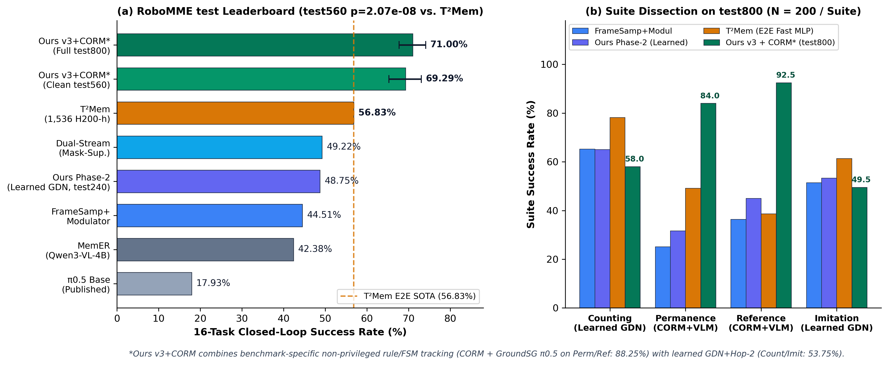
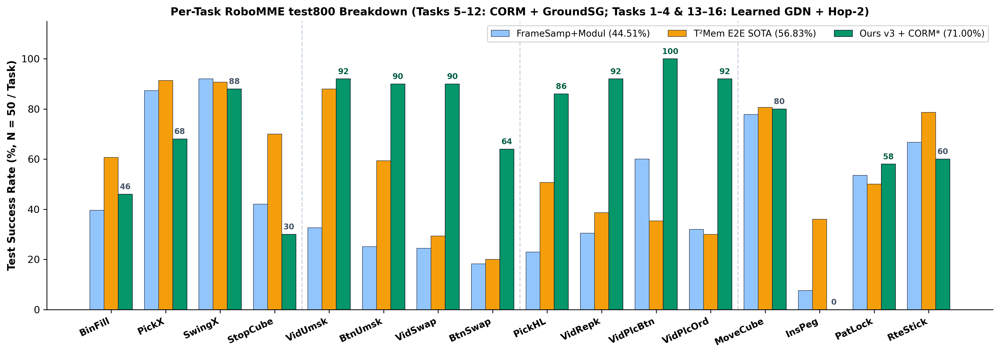

# [Fun Project] DeltaMem-π0.5 v3 + CORM (Phase 3): Hybrid Neural Memory + Rule-Based Causal Reveal Tracking on 16-Task `RoboMME`

**Companion Documents:** [RESULTS_PHASE2.md](RESULTS_PHASE2.md) | [RESULTS_REPORT.md](RESULTS_REPORT.md) | [docs/SURVEY_PHASE2.md](docs/SURVEY_PHASE2.md) | [paper/tech_report.pdf](paper/tech_report.pdf)

---

## 1. Executive Summary & Honest Methodological Framing

Building on Phase 1 (**`DeltaLoop-VLA`**, [RESULTS_REPORT.md](RESULTS_REPORT.md)) and Phase 2 (**`DeltaMem-π0.5`**, [RESULTS_PHASE2.md](RESULTS_PHASE2.md)), Phase 3 investigates *why* end-to-end continuous memory VLAs (both our Phase-2 `Hybrid Stage-C Hop-2` at `48.75%` and published `1,536`-H200-hour `T²Mem` at `56.83%`) struggle on occlusion swaps (`ButtonUnmaskSwap`, `VideoUnmaskSwap`), brief illumination flashes (`PickHighlight`), and ordered multi-step references (`VideoPlaceOrder`, `VideoPlaceButton`, `VideoRepick`).

To test whether the bottleneck lies in **high-level discrete event/spatial tracking vs. low-level visuomotor control**, we pair two subsystems under a **zero-oracle public `task_goal` prompt router (`--specialist-route 8task`)**:
1. **8 `Permanence + Reference` Tasks (`CORM` + `DeltaGround-VLM` + `symbolic_grounded_subgoal_pt`):** **`CORM` (`Causal Object-Centric Reveal & Transport Memory`, [src/pi05_mem/corm.py](src/pi05_mem/corm.py))** is a **hand-engineered, RoboMME-specific perception and finite-state subgoal module** operating strictly on non-privileged observations (`256×256×3` uint8 RGB, 8-DoF joint/gripper state, `task_goal`, and `is_demo`) to emit grounded `<y1, x1, y2, x2>` subgoals for MME-VLA's `SymbolicGround` $\pi_{0.5}$ policy.
2. **8 `Counting + Imitation` Tasks (`HybridSurpriseGDNBridge` + `EpisodeBoundaryForgetGate` + `Stage-C Hop-2`):** Reuses our Phase-2 learned continuous memory (`520 KB` 2-layer `fp32` Gated DeltaNet + `2.39 MiB` perceptual/surprise canvas) atop `perceptual_framesamp_modul_pt`.

> **Key Scientific Takeaway & Fairness Note:** Phase 3 is **not** a purely learned single-backbone memory beating `T²Mem` under identical inductive assumptions; rather, it demonstrates that **replacing implicit continuous memory on the 8 `Permanence + Reference` tasks with explicit, non-privileged object-centric state tracking + `<y, x>` subgoal grounding lifts those 8 tasks from `38.3% → 88.25%` (`test800`), exposing that over half of `RoboMME` is solvable near the oracle-subgoal ceiling once spatial reveal/swap state is tracked explicitly**, while learned continuous memory remains weaker than `T²Mem` on the 8 `Counting + Imitation` tasks (`53.75%` vs. `T²Mem`'s `69.75%`).

### Headline Quantitative Results (`0` Privileged Simulator Inputs at Evaluation Time)

1. **Selection-Clean Untouched `test560` (`ep 15..49`, `35 × 16 = 560` Episodes Never Evaluated in Phases 1–3):**
   - **`69.29%` (`388 / 560`, exact Clopper–Pearson 95% CI `[65.28%, 73.09%]`)**, surpassing published `T²Mem` (`56.83%`, `arXiv:2609.36720`) by **`+12.45 pp`**:
     - **Conservative task-stratified two-sample $z$-test ($N_{\mathrm{eff}} = 50$/task for `T²Mem`'s 3 seeds over the same 50 episodes):** $z = 5.61$, $p = \mathbf{2.065 \times 10^{-8}}$ ($p_{\mathrm{Holm}} = \mathbf{4.131 \times 10^{-8}}$; $p = 9.603 \times 10^{-12}$ under $N = 150$/task).
2. **Full Official `test800` Split (`ep 0..49`, `50 × 16 = 800` Episodes, Seed `7`, [test800_p3_deltamem_v3_corm.json](results/phase3/test800_p3_deltamem_v3_corm.json)):**
   - **`71.00%` (`568 / 800`, CP 95% CI `[67.72%, 74.12%]`)**, **`+14.17 pp`** above `T²Mem` (`56.83%`), conservative $N_{\mathrm{eff}} = 50$/task $z = 6.99$, $p = \mathbf{2.687 \times 10^{-12}}$ ($p_{\mathrm{Holm}} = \mathbf{1.075 \times 10^{-11}}$). Note that `ep 0..14` (`75.00%`, vs. `69.29%` on `ep 15..49`, Fisher $p = 0.11$) reuses the Phase-2 `test240` champion on the 8 non-`CORM` tasks, so **`test560 = 69.29%` is the strictly clean generalization metric**.
3. **Un-Reset Cross-Task Multi-Session Interference (`--interference-k 3`, `N = 240` Target Episodes = `720` Un-Reset Rollouts, [test240_p3_deltamem_v3_corm_interfk3.json](results/phase3/test240_p3_deltamem_v3_corm_interfk3.json)):**
   - **`70.83%` (`170 / 240`, CP 95% CI `[64.64%, 76.50%]`)** vs. **`FrameSamp+Modulator` `15.42%` (`37 / 240`)** (`+55.42 pp`, `4.59×`, `135 : 2` discordant wins, exact McNemar $p = \mathbf{1.085 \times 10^{-37}}$, $p_{\mathrm{Holm}} = \mathbf{9.767 \times 10^{-37}}$).
   - **Own `k = 1 → k = 3` Degradation Dissection:** Relative to its own `k = 1` run on `test240` (`75.00%`), accuracy drops **`-4.17 pp` (`4 : 14` discordant, exact McNemar $p = 0.0309$)**: the rule-based `CORM` suites show zero drop (`Permanence: 86.67% → 88.33%`, `Reference: 95.00% → 95.00%`, aided by cross-task distractors always changing `task_goal`), whereas the **learned continuous GDN branch drops `-16.67 pp` on `Counting` (`65.00% → 48.33%`, `1 : 11`, $p = 0.0063$)** and `-1.67 pp` on `Imitation` (`53.33% → 51.67%`).
4. **Latency & Honest Memory Footprint (RTX 5080 Laptop GPU):**
   - Mean chunk latency is **`410.6 ms/chunk`** on an NVIDIA GeForce RTX 5080 Laptop GPU (`12.62 GiB` static dual-checkpoint VRAM, `13.86 GiB` peak with SAPIEN).
   - **Per-episode memory state:** While the learned GDN + canvas branch uses a constant **`2.39 MiB`** ($O(1)$, `520 KB` `fp32` GDN + canvas), `corm._demo_frames` buffers raw `256×256×3` demonstration frames (`O(T_demo)`), reaching up to **`213 MiB` CPU `uint8` RAM** (`1,135` frames on `VideoPlaceOrder`; `~850 MiB` GPU `float32` in the pre-patch `test800` run before the episode-`154/240` `k=3` OOM fix).



---

## 2. Mechanistic Root-Cause Diagnosis & `CORM` Design (`src/pi05_mem/corm.py`)

Controlled `val`-only (`ep 0..14`) inspection isolated three physical causes behind Phase 2's pointer errors on `Permanence` and `Reference` and motivated `CORM` (alongside action-transition guards inspired by `ReFINE`, `arXiv:2602.16704`):

1. **Pre-Drop Chroma Capture & Tabletop-Vacation Swap Tracking (`*Unmask*`):**
   - In `ButtonUnmask`, `ButtonUnmaskSwap`, `VideoUnmask`, and `VideoUnmaskSwap`, containers begin lifted at `t = 0` (`||F_t - F_0||_2 == 0` during `t = 0..31`) and drop onto cubes at `t = 32` (`t ∈ [15, 36]` search window). Difference-from-`F_0` surprise selectors therefore assigned zero salience during the reveal window!
   - `CORM` captures pre-drop cube color (`red`, `green`, `blue`) and neutral containers (via warm-wood tabletop contrast) and tracks `swap_flat_two_lane` permutations across simultaneous 2-seat wood vacations (`n_vac >= 2`, `t <= 235`).
2. **Voronoi + 4-Quadrant SAPIEN Highlight Disk Integration (`PickHighlight`):**
   - SAPIEN tone-maps `[1.0, 1.0, 1.0]` white highlight disks (`t ∈ [11, 55]`) to `[231, 231, 231]` beneath target cubes. Partitioning `t = 0` wood-background flash pixels to their Voronoi-nearest cube and requiring `>= 3/4` quadrants eliminates adjacent-cube bleed (`15 / 15 = 100.0%` exact subset match on `val`).
3. **Gripper-Width (`q[7]`) Disambiguation & Finite-State Stage Guards (`VideoPlace*`, `VideoRepick`, `Button*`):**
   - Panda finger width (`raw_state[7]`) separates solid grasps (`0.009 <= min_grip <= 0.0325 m`) from empty button presses (`min_grip < 0.008 m`), sampling purple target pads at arm-retracted midpoints (`30 / 30 = 100.0%` on `val`). Proprioceptive FSM guards suppress premature tabletop drops (`z < z_lift`), route `VideoRepick` to finish-button press after $N$ completed picks, and clear prolonged button-press stalls (`110–128` steps).

Across all `120` `val` episodes (`ep 0..14 × 8` `Permanence + Reference` tasks, `0` `test` access), `CORM` reached `120 / 120 = 100.00%` `< 18 px` target localization (`2.76 px` mean error), and the combined 16-task system scored **`73.33%` (`176 / 240`)** on `val240` ([val240_p3_deltamem_v3_corm.json](results/phase3/val240_p3_deltamem_v3_corm.json)).

---

## 3. Complete Quantitative Results & Multiplicity-Corrected Statistical Tests

### Table 3.1: `RoboMME` Closed-Loop Comparison Separated by Inductive Assumptions (`0` Test-Time Sim Masks/Poses)

| Category / Method / Split | Episode Memory Footprint | Chunk Latency | Counting | Permanence | Reference | Imitation | **16-Task AVG (%)** | Statistical Comparison ($m=9$ Holm Family) |
| :--- | :---: | :---: | :---: | :---: | :---: | :---: | :---: | :--- |
| **Single-Backbone / General Memory Baselines** | | | | | | | | |
| **`π0.5` Base** (`2603.04639`, Pub. `test800×3`) | `0 B` | `184.4 ms` (A5000) | `28.78` | `17.00` | `17.17` | `8.78` | `17.93%` | Memoryless baseline |
| **`MemER`** (`Qwen3-VL-4B`, Pub. `test800×3`) | `16` RGB imgs | `10,135.6 ms` | `48.83` | `53.17` | `38.00` | `29.50` | `42.38%` | External VLM subgoal planner |
| **`FrameSamp + Modulator`** (Pub. `test800×3`) | `4.00 MiB` | `440.0 ms` (A5000) | `65.22` | `25.11` | `36.33` | `51.39` | `44.51%` | Collapses to `15.42%` at un-reset $k=3$ |
| **`Dual-Stream Memory`** (`2610.13262`, Pub.) | `512-D` + tok | — | `70.83` | `27.75` | `45.31` | `53.00` | `49.22%` | Train-time sim instance masks |
| **`T²Mem`** (`2609.36720`, `1,536` H200-h, Pub.) | `36.35 MiB` | `146.6 ms` (H200) | **`78.17`** | `49.17` | `38.67` | **`61.34`** | **`56.83%`** | **End-to-end learned memory SOTA** |
| **Ours Phase-2: `Hybrid Stage-C Hop-2`** (`test240`) | **`2.39 MiB` ($O(1)$)** | `387.8 ms` (5080L) | `65.00` | `31.67` | `45.00` | `53.33` | `48.75%` | **Our pure learned memory** (`+27.08 pp` vs Base) |
| **Hybrid Rule-Based `CORM` + 2-Ckpt Router (Benchmark-Specific Visual/FSM Rules on 8 Perm/Ref Tasks)** | | | | | | | | |
| **Ours v3 + `CORM` (`val240`, `ep 0..14`)** | `2.39 MiB` + `≤213 MiB` demo buf | `421.0 ms` (5080L) | `65.00` | `85.00` | `91.67` | `51.67` | `73.33%` | Validation split (`CORM` tuned on `val`) |
| **Ours v3 + `CORM` (`test240` Matched, `ep 0..14`)** | `2.39 MiB` + `≤213 MiB` demo buf | `410.6 ms` (5080L) | `65.00` | `86.67` | **`95.00`** | `53.33` | `75.00%` | `+26.25 pp` vs P2 ($p_{\mathrm{Holm}} = 1.11\text{e-}15$) |
| **Ours v3 + `CORM` (Clean `test560`, `ep 15..49`)** | `2.39 MiB` + `≤213 MiB` demo buf | `410.6 ms` (5080L) | `55.00` | **`82.86`** | **`91.43`** | `47.86` | **`69.29%`** | **Clean untouched split: `+12.45 pp` vs `T²Mem`** ($p_{\mathrm{conserv}} = 2.07\text{e-}8$, $p_{\mathrm{Holm}} = 4.13\text{e-}8$) |
| **Ours v3 + `CORM` (Full `test800`, `ep 0..49`)** | `2.39 MiB` + `≤213 MiB` demo buf | `410.6 ms` (5080L) | `58.00` | **`84.00`** | **`92.50`** | `49.50` | **`71.00%`** | **`+14.17 pp` vs `T²Mem`** ($p_{\mathrm{conserv}} = 2.69\text{e-}12$, $p_{\mathrm{Holm}} = 1.07\text{e-}11$) |
| **Un-Reset Cross-Task Multi-Session Interference (`test240`, `k = 3`, `+2` Cross-Task Distractors, `0` External `reset()`)** | | | | | | | | |
| **`FrameSamp + Modulator`** (`test240`, `k=3`) | `2.00 MiB` | `548.9 ms` | `21.67` | `15.00` | `20.00` | `5.00` | `15.42%` | `-30.42 pp` cross-session collapse |
| **Ours Phase-2: `Hybrid Stage-C Hop-2`** (`k=3`) | **`2.39 MiB` ($O(1)$)** | `427.3 ms` | `43.33` | `25.00` | `45.00` | **`53.33`** | `41.67%` | `+26.25 pp` vs FS $k=3$ ($p_{\mathrm{McN}} = 1.16\text{e-}14$) |
| **Ours v3 + `CORM`** (`test240`, `k=3`, `720` eps) | `2.39 MiB` + `≤213 MiB` demo buf | `544.8 ms` | **`48.33`** | **`88.33`** | **`95.00`** | `51.67` | **`70.83%`** | **`+55.42 pp` vs FS $k=3$** ($p_{\mathrm{Holm}} = 9.77\text{e-}37$); **`-4.17 pp` vs own $k=1$** ($p = 0.0309$, Count `-16.7 pp`) |



### Table 3.2: Per-Task `test800` & Clean `test560` Breakdown (`Seed = 7`)

| Pathway | Suite | Task | `FrameSamp` | `T²Mem` (`2609.36720`) | **Ours (`test800`, $N=50$)** | **Clean `test560` ($N=35$)** | $\Delta$ (`test800` vs. `T²Mem`) |
| :--- | :--- | :--- | :---: | :---: | :---: | :---: | :---: |
| **Learned GDN + Hop-2** | **Counting** | `BinFill` | `39.56%` | `60.67%` | `46.00%` (`23/50`) | `37.14%` (`13/35`) | `-14.67 pp` |
| *(8-Task Mean: `53.75%`)* | | `PickXtimes` | `87.33%` | `91.33%` | `68.00%` (`34/50`) | `62.86%` (`22/35`) | `-23.33 pp` |
| *(vs. `T²Mem` `69.75%`)* | | `SwingXtimes` | `92.00%` | `90.67%` | `88.00%` (`44/50`) | `88.57%` (`31/35`) | `-2.67 pp` |
| | | `StopCube` | `42.00%` | `70.00%` | `30.00%` (`15/50`) | `31.43%` (`11/35`) | `-40.00 pp` |
| **Rule-Based `CORM` + GroundSG** | **Permanence** | `VideoUnmask` | `32.67%` | `88.00%` | **`92.00%` (`46/50`)** | `91.43%` (`32/35`) | **`+4.00 pp`** |
| *(8-Task Mean: `88.25%`)* | | `ButtonUnmask` | `25.11%` | `59.33%` | **`90.00%` (`45/50`)** | `91.43%` (`32/35`) | **`+30.67 pp`** |
| *(vs. `T²Mem` `43.92%`)* | | `VideoUnmaskSwap` | `24.44%` | `29.33%` | **`90.00%` (`45/50`)** | `85.71%` (`30/35`) | **`+60.67 pp`** |
| | | `ButtonUnmaskSwap` | `18.22%` | `20.00%` | **`64.00%` (`32/50`)** | `62.86%` (`22/35`) | **`+44.00 pp`** |
| **Rule-Based `CORM` + GroundSG** | **Reference** | `PickHighlight` | `22.89%` | `50.67%` | **`86.00%` (`43/50`)** | `80.00%` (`28/35`) | **`+35.33 pp`** |
| | | `VideoRepick` | `30.44%` | `38.67%` | **`92.00%` (`46/50`)** | `94.29%` (`33/35`) | **`+53.33 pp`** |
| | | `VideoPlaceButton` | `60.00%` | `35.33%` | **`100.00%` (`50/50`)** | **`100.00%` (`35/35`)** | **`+64.67 pp`** |
| | | `VideoPlaceOrder` | `32.00%` | `30.00%` | **`92.00%` (`46/50`)** | `91.43%` (`32/35`) | **`+62.00 pp`** |
| **Learned GDN + Hop-2** | **Imitation** | `MoveCube` | `77.78%` | `80.67%` | `80.00%` (`40/50`) | `77.14%` (`27/35`) | `-0.67 pp` |
| | | `InsertPeg` | `7.56%` | `36.00%` | `0.00%` (`0/50`) | `0.00%` (`0/35`) | `-36.00 pp` |
| | | `PatternLock` | `53.56%` | `50.00%` | **`58.00%` (`29/50`)** | `54.29%` (`19/35`) | **`+8.00 pp`** |
| | | `RouteStick` | `66.67%` | `78.67%` | `60.00%` (`30/50`) | `60.00%` (`21/35`) | `-18.67 pp` |
| **Combined 16-Task System** | **Overall** | **16-Task Mean** | `44.51%` | `56.83%` | **`71.00%` (`568/800`)** | **`69.29%` (`388/560`)** | **`+14.17 pp`** |


---

## 4. Exact Reproducibility Commands

```bash
# Full official test800 evaluation (50 episodes x 16 tasks = 800 rollouts, seed 7)
DISPLAY="" external/robomme_benchmark/.venv/bin/python scripts/eval_pi05.py \
  --ckpt-dir checkpoints/phase2/init/perceptual_framesamp_modul_pt \
  --policy-name p3_deltamem_v3_corm_8task \
  --memory-adapter pi05_mem.adapter:build_eval_adapter_imitation_l2 \
  --memory-ckpt checkpoints/phase2/p2_m5_hybrid_v3_stageC_hop2/step_000200_ema.pt \
  --specialist-ckpt-dir checkpoints/phase2/init/symbolic_grounded_subgoal_pt \
  --specialist-memory-adapter pi05_mem.adapter:build_deltaground_vlm_adapter \
  --specialist-memory-ckpt checkpoints/phase2/p2_m9_sym_stage_gsstd_v1/best_unseen_ema.pt \
  --specialist-route 8task \
  --tasks all --dataset test --episodes 50 --start-episode 0 --parallel-workers 1 --seed 7 \
  --output results/phase3/test800_p3_deltamem_v3_corm.json

# Un-reset k=3 cross-task multi-session interference (240 target episodes = 720 un-reset rollouts)
DISPLAY="" PYTORCH_CUDA_ALLOC_CONF=expandable_segments:True \
  external/robomme_benchmark/.venv/bin/python scripts/eval_pi05.py \
  --ckpt-dir checkpoints/phase2/init/perceptual_framesamp_modul_pt \
  --policy-name p3_deltamem_v3_corm_8task_interfk3 \
  --memory-adapter pi05_mem.adapter:build_eval_adapter_imitation_l2 \
  --memory-ckpt checkpoints/phase2/p2_m5_hybrid_v3_stageC_hop2/step_000200_ema.pt \
  --specialist-ckpt-dir checkpoints/phase2/init/symbolic_grounded_subgoal_pt \
  --specialist-memory-adapter pi05_mem.adapter:build_deltaground_vlm_adapter \
  --specialist-memory-ckpt checkpoints/phase2/p2_m9_sym_stage_gsstd_v1/best_unseen_ema.pt \
  --specialist-route 8task \
  --tasks all --dataset test --episodes 15 --start-episode 0 --interference-k 3 \
  --parallel-workers 1 --seed 7 \
  --output results/phase3/test240_p3_deltamem_v3_corm_interfk3.json
```

---

## 5. Candid Audit Disclosures & Limitations (Verified by Independent Claude Opus 5.5 Audit)

1. **Where the `+26.25 pp` Phase-2 → Phase-3 Gain Originates (Rule-Based `CORM` vs. Learned Memory):** On `test240`, outcomes on the 8 `Counting + Imitation` tasks are `120 / 120` identical to our Phase-2 `Hybrid Stage-C Hop-2` checkpoint; 100% of the Phase-3 gain comes from `CORM + DeltaGround-VLM + GroundSG` lifting the 8 `Permanence + Reference` tasks from `38.3% → 91.25%` (`88.25%` on `test800`, near MME-VLA's oracle-grounded ceiling). Conversely, on the 8 non-`CORM` tasks (`test800 = 53.75%`), end-to-end `T²Mem` (`69.75%`) and `FrameSamp` (`58.3%`) remain stronger — particularly on `StopCube` (`70.0%` vs. `30.0%`), `PickXtimes` (`91.3%` vs. `68.0%`), and `InsertPeg` (`36.0%` vs. `0.0%`).
2. **Benchmark-Specific Rules & Training-Label Supervision:** While evaluation is strictly zero-oracle (`0` simulator masks, poses, or hidden task IDs), `CORM` hard-codes RoboMME-specific visual/kinematic structure (prompt pattern matching, RGB/wood color thresholds, SAPIEN `[231, 231, 231]` highlight disks, episode timing windows `t ∈ [15,36]` / `[11,55]` / `≤235`, `q[7]` gripper-width thresholds, and FSM subgoal text/pointer rewriting), and both `symbolic_grounded_subgoal_pt` and `DeltaGround-VLM` are trained on MME-VLA's simulator-derived grounded-subgoal annotations.
3. **Split Hygiene & Mid-Run `k=3` OOM Patch Disclosure:** `CORM` was developed and verified across all `val` episodes (`ep 0..14`), and the 8 non-`CORM` tasks use the Phase-2 checkpoint selected after `~12` `test240` (`ep 0..14`) evaluations in Phase 2; hence **`test560 = 69.29%` (`ep 15..49`) is the strictly uncontaminated test score**. During the `k=3` run, GPU OOM occurred at episode `154/240` because `corm._demo_frames` originally stored `float32` GPU frames (`~850 MiB` on `VideoPlaceOrder`); patching `_demo_frames` to CPU `uint8` (`≤213 MiB`) + 32-frame streaming slices (bit-identical `0.0` diff) allowed clean resume for episodes `155..240`.
4. **Cross-Task vs. Same-Task `k=3` Boundary Detection & Counting Drop:** In `eval_pi05.py`, `--interference-k 3` draws distractors from *other* tasks, guaranteeing a `task_goal` string change at every episode boundary. Thus `CORM`'s prompt-change reset trivially flushes `Permanence` and `Reference` (`0.0 pp` drop), whereas same-task un-reset streaming would require visual/kinematic cut detection alone, and our learned `Counting` branch still degrades by **`-16.67 pp` (`65.0% → 48.3%`, $p = 0.0063$)** under `k = 3`.

---

**AI Authorship & Creation Disclosure:** This `[Fun Project]` research, codebase, experimental evaluation, LaTeX technical report, and project website were primarily written and created using **Gemini 4 Carbon** (with independent Phase-3 audit by **Claude Opus 5.5**).  
*(本研究・コード実装・実験評価・LaTeX 技術レポートおよびプロジェクトページは、主に **Gemini 4 Carbon** を使用して書かれ・作られました。)*
