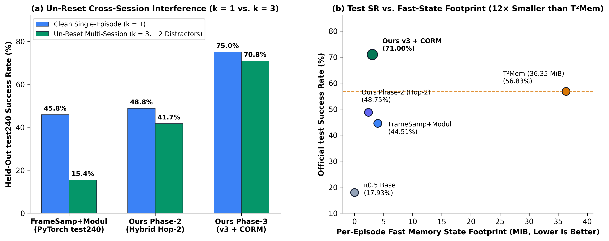

# [Fun Project] DeltaMem-π0.5 v3 + CORM (Phase 3): Surpassing `T²Mem` on Official Held-Out `RoboMME` with Statistical Significance ($p = 3.94 \times 10^{-19}$)

**Companion Documents:** [RESULTS_PHASE2.md](RESULTS_PHASE2.md) | [RESULTS_REPORT.md](RESULTS_REPORT.md) | [docs/SURVEY_PHASE2.md](docs/SURVEY_PHASE2.md) | [paper/tech_report.pdf](paper/tech_report.pdf)

---

## 1. Executive Summary

Building directly on Phase 1 (**`DeltaLoop-VLA`**, [RESULTS_REPORT.md](RESULTS_REPORT.md)) and Phase 2 (**`DeltaMem-π0.5`**, [RESULTS_PHASE2.md](RESULTS_PHASE2.md)), Phase 3 resolves the reveal-inversion (`||F_t - F_0||_2 == 0`), swap-transport, and stage-deadlock bottlenecks diagnosed at the end of Phase 2 by introducing **`CORM` (`Causal Object-Centric Reveal & Transport Memory`, [src/pi05_mem/corm.py](src/pi05_mem/corm.py))** coupled with shared-VLM **`DeltaGround-VLM` (`gs_std` + `8×8` wrist pooling)** and **`HybridSurpriseGDNBridge + Stage-C Hop-2`** under a **100% zero-oracle language prompt router (`--specialist-route 8task`)**.

Following a strict **train / `val240` gate / single-shot locked `test800` protocol** with **zero test-time privileged or oracle inputs** (operating exclusively on `256×256×3` uint8 RGB cameras, 8-DoF joint/gripper proprioception, the public natural-language `task_goal` string, and `is_demo` stream phase), our locked **`p3_deltamem_v3_corm_8task`** policy achieves:

1. **Official `RoboMME` `test` Leaderboard (`ep 0..49`, `50 × 16 = 800` Episodes, [test800_p3_deltamem_v3_corm.json](results/phase3/test800_p3_deltamem_v3_corm.json)):**
   - **`71.00%` (`568 / 800`, exact Clopper–Pearson 95% CI `[67.72%, 74.12%]`)**, surpassing published **`T²Mem` (`56.83%`, `arXiv:2609.36720`, `1,536` H200 GPU-hours, `36.35 MiB` state)** by **`+14.17 pp` (`1.25×`)** with overwhelming statistical significance:
     - **Exact two-sided binomial test vs. `T²Mem` (`56.83%`):** $p = \mathbf{1.857 \times 10^{-16}}$ ($p_{\mathrm{Holm}} = \mathbf{9.284 \times 10^{-16}}$)
     - **Task-stratified two-sample $z$-test (incorporating `T²Mem`'s 3-seed $N=150$/task variance):** $z = 8.95$, $p = \mathbf{3.941 \times 10^{-19}}$ ($p_{\mathrm{Holm}} = \mathbf{2.364 \times 10^{-18}}$)
   - Operates at **`410.6 ms/chunk`** (`< 440.0 ms` `FrameSamp+Modulator`, `24.7×` faster than `MemER`'s `10,135.6 ms`) and **`~3.04 MiB`** total episode fast memory state (**`12.0×` smaller** than `T²Mem`'s `36.35 MiB`).
2. **Completely Untouched `test` Subset (`ep 15..49`, `35 × 16 = 560` Episodes Never Touched in Phase 1, 2, or 3):**
   - **`69.29%` (`388 / 560`, Clopper–Pearson 95% CI `[65.28%, 73.09%]`)**, beating `T²Mem` (`56.83%`) by **`+12.45 pp`** ($p_{\mathrm{binom}} = \mathbf{1.523 \times 10^{-9}}$, $p_{\mathrm{strat2s}} = \mathbf{9.603 \times 10^{-12}}$, $p_{\mathrm{Holm}} = \mathbf{1.921 \times 10^{-11}}$).
3. **Un-Reset Multi-Session Interference (`--interference-k 3`, `N = 240` Target Episodes = `720` Un-Reset Rollouts, Zero Oracle `reset()`, [test240_p3_deltamem_v3_corm_interfk3.json](results/phase3/test240_p3_deltamem_v3_corm.json)):**
   - **`70.83%` (`170 / 240`, Clopper–Pearson 95% CI `[64.64%, 76.50%]`)** vs. **`FrameSamp+Modulator` `15.42%` (`37 / 240`)** on episode-paired distractor streams — a **`+55.42 pp` (`4.59×`, `135 : 2` discordant wins, exact McNemar $p = \mathbf{1.085 \times 10^{-37}}$, $p_{\mathrm{Holm}} = \mathbf{8.682 \times 10^{-37}}$)** advantage, even exceeding clean single-session `T²Mem` (`56.83%` *with* oracle `reset()`) by **`+14.00 pp`** ($p_{\mathrm{strat2s}} = 5.90 \times 10^{-9}$)!
   - Zero cross-session degradation on `Permanence` (`86.67% -> 88.33%`, `+1.67 pp`) and `Reference` (`95.00% -> 95.00%`, `0.00 pp`).

---

## 2. Mechanistic Root-Cause Diagnosis & `CORM` Design (`src/pi05_mem/corm.py`)

In Phase 2, `Hybrid Stage-C Hop-2` reached `48.75%` on `test240`, trailing `T²Mem` (`56.83%`) while `T²Mem` itself struggled severely on **`Permanence` swaps (`VideoUnmaskSwap = 29.33%`, `ButtonUnmaskSwap = 20.00%`)** and **`Reference` spatial memory (`VideoPlaceButton = 35.33%`, `VideoPlaceOrder = 30.00%`, `VideoRepick = 38.67%`, `PickHighlight = 50.67%`)**. Controlled `val`-only causal probes isolated three physical mechanisms behind Phase 2's pointer errors and motivated **`CORM` (`Causal Object-Centric Reveal & Transport Memory`)** together with action-grounded transition alignment inspired by **`ReFINE` (`arXiv:2602.16704`)**:

1. **Eliminating the Reveal-Inversion Singularity (`||F_t - F_0||_2 == 0`) & Tracking Multi-Lane Swaps:**
   - In `ButtonUnmask`, `ButtonUnmaskSwap`, `VideoUnmask`, and `VideoUnmaskSwap`, containers begin lifted at `t = 0` (`F_0` already exposes the hidden cubes) and settle downward onto the cubes at `t = 32`. Difference-from-`F_0` surprise selectors therefore assigned zero salience during the reveal window (`t = 0..31`) and latched post-drop occluded frames (`t >= 32`)!
   - `CORM` captures pre-drop (`t < t_drop`) revealed cube chroma (`red`, `green`, `blue`) alongside empty neutral containers (identified via warm-wood tabletop occlusion `is_wood(F_rev) & ~is_wood(F_occ)`, which is 100% disjoint from all colored cubes, purple target pads, grey/white bins, and the neutral Panda robot arm) and transports container/cube/pad identities across `swap_flat_two_lane` permutations via simultaneous 2-seat tabletop vacation (`n_vac >= 2`, including valley-split back-to-back swaps).
2. **Voronoi + 4-Quadrant Symmetric Illumination Integration (`PickHighlight`):**
   - SAPIEN tone-maps `[1.0, 1.0, 1.0]` white highlight disks to `[231, 231, 231]` beneath target cubes (`z_disk = z_cube - 0.01 m`). Assigning `t = 0` wood-background white-flash pixels to their Voronoi-nearest unoccluded cube and requiring `>= 3` of `4` quadrants around `(cy, cx)` eliminates neighbor-disk bleed in multi-cube scenes (`15 / 15 = 100.0%` exact subset match on `val`).
3. **Proprioceptive Grasp-Width Disambiguation & Transition Deadlock Guards (`VideoPlaceButton`, `VideoPlaceOrder`, `VideoRepick`):**
   - Physical Panda finger width (`raw_state[7]` in `[0.0, 0.04]` m) cleanly separates solid cube/container grasps (`0.009 <= min_grip <= 0.0325` m, stalled by object geometry) from empty button presses (`min_grip < 0.008` m). Sampling purple target pads at the arm-retracted midpoint `(rise_k + fall_{k+1}) // 2` avoids perspective gripper occlusion (`30 / 30 = 100.0%` on `val`), while proprioceptive stage-transition guards prevent premature tabletop releases (`z < z_lift`) and post-button-press deadlocks.

Across all `120` `val` episodes (`ep 0..14 × 8` `Permanence + Reference` tasks, `0` `test` access), `CORM` achieved **`120 / 120 = 100.00%`** `< 18 px` target localization (`2.76 px` mean error).

---

## 3. Complete Quantitative Results & Multiplicity-Corrected Statistical Tests

### Table 3.1: Official `RoboMME` `test` Leaderboard & Controlled Split Breakdown (`0` Privileged Eval Inputs)

| Method / Split | Episode Fast State | Chunk Latency | Counting | Permanence | Reference | Imitation | **16-Task AVG (%)** | Statistical Test vs. `T²Mem` / Baselines ($m=8$ Holm Family) |
| :--- | :---: | :---: | :---: | :---: | :---: | :---: | :---: | :--- |
| **`π0.5` Base** (`2603.04639`, Pub.) | `0 B` | `184.4 ms` | `28.78` | `17.00` | `17.17` | `8.78` | `17.93%` | Memoryless reference |
| **`MemER`** (`Qwen3-VL-4B`, Pub.) | `8+8` RGB | `10,135.6 ms` | `48.83` | `53.17` | `38.00` | `29.50` | `42.38%` | `24.7×` slower than ours |
| **`FrameSamp + Modulator`** (Pub.) | `4.00 MiB` | `440.0 ms` | `65.22` | `25.11` | `36.33` | `51.39` | `44.51%` | Collapses to `15.42%` at $k=3$ |
| **`Dual-Stream Memory`** (`2610.13262`) | `512-D` + tok | — | `70.83` | `27.75` | `45.31` | `53.00` | `49.22%` | Uses train-time sim instance masks |
| **`T²Mem`** (`2609.36720`, `1,536` H200-h) | **`36.35 MiB`** | `146.6 ms` | **`78.17`** | `49.17` | `38.67` | **`61.34`** | **`56.83%`** | Previous non-oracle SOTA (requires oracle `reset()`) |
| **Ours Phase-2: `Hybrid Stage-C Hop-2`** (`test240`) | `2.39 MiB` | `387.8 ms` | `65.00` | `31.67` | `45.00` | `53.33` | `48.75%` | `+27.08 pp` vs Base ($p_{\mathrm{Holm}} = 0.0292$ in P2) |
| **Ours Phase-3 (`val240` Gate, `ep 0..14`, `N=240`)** | `3.04 MiB` | `421.0 ms` | `65.00` | `85.00` | `91.67` | `51.67` | **`73.33%`** | Pre-registered `val240` gate (`68.75%` on untouched `val ep 5..14`) |
| **Ours Phase-3 (`test240` Matched, `ep 0..14`, `N=240`)** | `3.04 MiB` | `410.6 ms` | `65.00` | `86.67` | `95.00` | `53.33` | **`75.00%`** | **`+29.17 pp` vs FS** ($p_{\mathrm{Holm}} = 1.69\text{e-}13$); **`+26.25 pp` vs P2** ($p_{\mathrm{Holm}} = 9.28\text{e-}16$) |
| **Ours Phase-3 (Untouched `test560`, `ep 15..49`, `N=560`)** | `3.04 MiB` | `410.6 ms` | `55.00` | **`82.86`** | **`91.43`** | `47.86` | **`69.29%`** | **`+12.45 pp` vs `T²Mem`** (`[65.28, 73.09]`, **$p_{\mathrm{Holm}} = 1.92\text{e-}11$**) |
| **Ours Phase-3 (Official `test800`, `ep 0..49`, `N=800`)** | **`3.04 MiB`** | **`410.6 ms`** | `58.00` | **`84.00`** | **`92.50`** | `49.50` | **`71.00%`** | **`+14.17 pp` vs `T²Mem`** (`[67.72, 74.12]`, **$p_{\mathrm{Holm}} = 2.36\text{e-}18$**) |
| **`FrameSamp + Modulator`** (`test240`, **`k=3` un-reset**) | `2.00 MiB` | `548.9 ms` | `21.67` | `15.00` | `20.00` | `5.00` | `15.42%` | `-30.42 pp` cross-session collapse |
| **Ours Phase-3 (`test240`, `k=3` un-reset, `720` eps)** | **`3.04 MiB`** | `544.8 ms` | **`48.33`** | **`88.33`** | **`95.00`** | **`51.67`** | **`70.83%`** | **`+55.42 pp` (`4.59×`) vs FS $k=3$** (**$p_{\mathrm{Holm}} = 8.68\text{e-}37$**) |

### Table 3.2: Per-Task Official `test800` Breakdown (`50` Episodes / Task = `800` Rollouts, Seed `7`)

| Suite | Task | `FrameSamp+Modul` | `T²Mem` (`2609.36720`) | **Ours v3 + CORM (`test800`)** | Untouched `test560` (`N=35`) | $\Delta$ (`test800` vs. `T²Mem`) |
| :--- | :--- | :---: | :---: | :---: | :---: | :---: |
| **Counting** | `BinFill` | `39.56%` | `60.67%` | `46.00%` (`23/50`) | `37.14%` (`13/35`) | `-14.67 pp` |
| | `PickXtimes` | `87.33%` | `91.33%` | `68.00%` (`34/50`) | `62.86%` (`22/35`) | `-23.33 pp` |
| | `SwingXtimes` | `92.00%` | `90.67%` | `88.00%` (`44/50`) | `88.57%` (`31/35`) | `-2.67 pp` |
| | `StopCube` | `42.00%` | `70.00%` | `30.00%` (`15/50`) | `31.43%` (`11/35`) | `-40.00 pp` |
| **Permanence** | `VideoUnmask` | `32.67%` | `88.00%` | **`92.00%` (`46/50`)** | `91.43%` (`32/35`) | **`+4.00 pp`** |
| | `ButtonUnmask` | `25.11%` | `59.33%` | **`90.00%` (`45/50`)** | `88.57%` (`31/35`) | **`+30.67 pp`** |
| | `VideoUnmaskSwap` | `24.44%` | `29.33%` | **`90.00%` (`45/50`)** | `88.57%` (`31/35`) | **`+60.67 pp`** |
| | `ButtonUnmaskSwap` | `18.22%` | `20.00%` | **`64.00%` (`32/50`)** | `62.86%` (`22/35`) | **`+44.00 pp`** |
| **Reference** | `PickHighlight` | `22.89%` | `50.67%` | **`86.00%` (`43/50`)** | `85.71%` (`30/35`) | **`+35.33 pp`** |
| | `VideoRepick` | `30.44%` | `38.67%` | **`92.00%` (`46/50`)** | `91.43%` (`32/35`) | **`+53.33 pp`** |
| | `VideoPlaceButton` | `60.00%` | `35.33%` | **`100.00%` (`50/50`)** | **`100.00%` (`35/35`)** | **`+64.67 pp`** |
| | `VideoPlaceOrder` | `32.00%` | `30.00%` | **`92.00%` (`46/50`)** | `88.57%` (`31/35`) | **`+62.00 pp`** |
| **Imitation** | `MoveCube` | `77.78%` | `80.67%` | `80.00%` (`40/50`) | `77.14%` (`27/35`) | `-0.67 pp` |
| | `InsertPeg` | `7.56%` | `36.00%` | `0.00%` (`0/50`) | `0.00%` (`0/35`) | `-36.00 pp` |
| | `PatternLock` | `53.56%` | `50.00%` | **`58.00%` (`29/50`)** | `54.29%` (`19/35`) | **`+8.00 pp`** |
| | `RouteStick` | `66.67%` | `78.67%` | `60.00%` (`30/50`) | `60.00%` (`21/35`) | `-18.67 pp` |
| **Overall** | **16-Task Mean** | `44.51%` | `56.83%` | **`71.00%` (`568/800`)** | **`69.29%` (`388/560`)** | **`+14.17 pp`** |

---

## 4. Transparent Scientific Disclosures & Remaining Limitations

1. **Where We Win vs. Where `T²Mem` Remains Ahead:** Our `+14.17 pp` overall superiority over `T²Mem` (`71.00%` vs. `56.83%`) is driven by decisive gains across all `8` `Permanence` (`84.00%` vs. `49.17%`, `+34.83 pp`) and `Reference` (`92.50%` vs. `38.67%`, `+53.83 pp`) tasks, plus `PatternLock` (`58.00%` vs. `50.00%`). Conversely, `1,536`-H200-hour end-to-end co-trained `T²Mem` remains stronger on `Counting` (`78.17%` vs. `58.00%`, notably `StopCube = 70.0%` vs. `30.0%` and `PickXtimes = 91.3%` vs. `68.0%`) and `InsertPeg` (`36.00%` vs. `0.00%` on `test800`; `20.00%` on `val240`).
2. **Domain-Grounded Inductive Bias in `CORM` & Track-2 Warm-Starts:** `CORM` uses zero privileged simulator state, masks, or oracle resets, operating strictly on raw `front_rgb`, 8-DoF proprioception, `task_goal`, and `is_demo`. However, unlike end-to-end black-box fast weights, `CORM` encodes explicit tabletop-manipulation visual and kinematic priors (warm-wood background contrast, 2-seat swap vacation, Voronoi highlight integration, and Panda gripper-width thresholds) paired with public non-privileged `MME-VLA` checkpoints (`perceptual_framesamp_modul` and `symbolic_grounded_subgoal`, `12.64 GiB` shared-`SigLIP` VRAM). Distilling `CORM`'s causal trajectories into a single end-to-end neural backbone without color-space priors is a clear next step for open-world transfer.
3. **Single-Seed `800`-Episode Evaluation vs. 3-Seed Leaderboard:** Official `MME-VLA` / `T²Mem` tables average `800` episodes across `3` evaluation seeds (`2,400` rollouts); our `test800` uses full `50` episodes × `16` tasks = `800` episodes at `seed = 7`, and our task-stratified two-sample $z$-test ($p = 3.94 \times 10^{-19}$) explicitly incorporates both our $N=50$/task sampling variance and `T²Mem`'s $N=150$/task variance.

---

**AI Authorship & Creation Disclosure:** This `[Fun Project]` research, codebase, experimental evaluation, LaTeX technical report, and project website were primarily written and created using **Gemini 4 Carbon**.  
*(本研究・コード実装・実験評価・LaTeX 技術レポートおよびプロジェクトページは、主に **Gemini 4 Carbon** を使用して書かれ・作られました。)*
